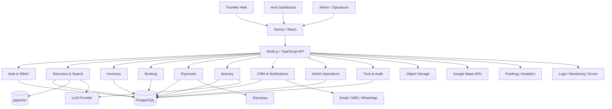
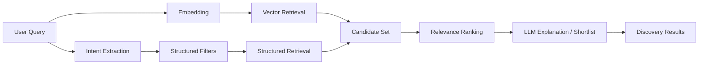
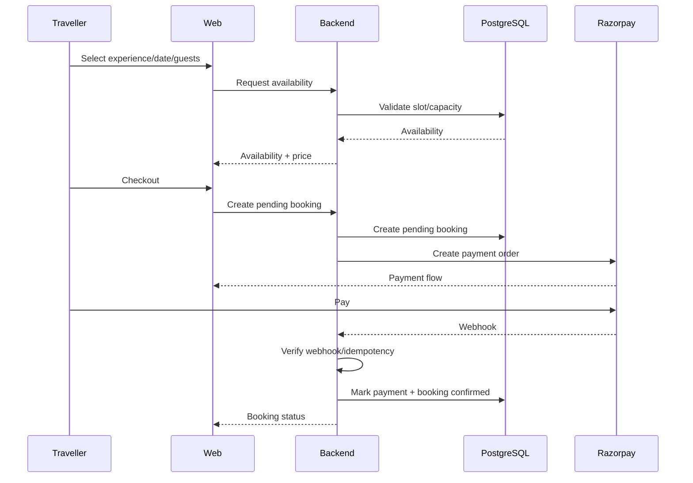

# La Vivenzia — System Design

## 1. Architecture Style

Initial architecture:

**Modular Monolith + API-first boundaries**

The system should have strong internal modules without forcing separate deployable microservices before scale requires them.

### Phase 1 topology

Decided in ADR-0002. One Next.js application on the Node runtime, serving both the UI and a versioned `/api/v1/*` REST surface, plus a **separate worker process built from the same codebase**. Two processes, one artifact, two start commands.

`System Design.png` shows a separate Node API service on ECS. That describes the Phase 2+ target, not the launch runtime; the diagram is a non-authoritative reference (ADR-0003).

The property that makes this reversible is a hard internal boundary: `src/modules` (domain logic) and `src/ports` (provider interfaces the domain owns) import nothing from Next.js, React, or any outward layer. This is enforced by lint, not convention. Extracting a standalone API service later is then a matter of writing new HTTP adapters over services that already exist.

The API is client-agnostic from day one — the web frontend consumes `/api/v1` exactly as a future mobile client will. There is no privileged internal path.

Extract the API service when a second first-class client ships, or when AI/search load demonstrably needs scaling independent of page rendering.

## 2. High-Level System



## 3. Frontend

Next.js + React + TypeScript.

Responsibilities:

- Rendering
- Routing
- Form UX
- Search UI
- Booking UI
- Host/admin dashboards
- Client-side interaction
- Calling backend APIs

The frontend must not own authoritative booking/payment decisions.

## 4. Backend Modules

```text
auth
users
travellers
hosts
verification
experiences
categories
locations
search
availability
bookings
payments
invoices
refunds
commissions
payouts
reviews
wishlists
itineraries
notifications
crm
analytics
admin
audit
```

## 5. Database

PostgreSQL is the system of record.

Use Prisma for database access.

Use pgvector for embedding/vector similarity where semantic discovery requires it.

### Extensions

Enabled from the foundation (ADR-0004), created by the initial migration so every environment is provisioned identically: `pgcrypto`, `citext`, `pg_trgm`, `postgis`, `vector`.

`postgis` is enabled from the start (ADR-0008) because FR-03 makes nearby and map-viewport discovery a launch requirement, and retrofitting a spatial column onto populated core tables is far more expensive than enabling the extension on an empty database.

`vector` is enabled but **no vector column exists yet**. The embedding provider is unresolved and it fixes the vector dimension (ADR-0007). No vector column may be added until that decision is made.

Full detail, including the RDS privilege requirement and schema conventions, is in `docs/DATABASE.md`.

## 6. Search Architecture



Rules:

- Structured filters remain deterministic.
- Vector retrieval provides semantic candidates.
- Ranking combines relevance, availability, quality and business rules.
- LLM output must not invent availability, pricing or booking state.

### What is built (ADR-0014)

The diagram above is the target. As of Phase 5.1 the **left and bottom paths are
real and the vector path is not**:

| Stage                | State                                                           |
| -------------------- | --------------------------------------------------------------- |
| Structured retrieval | Built — category, destination, price, duration, proximity        |
| Keyword retrieval    | Built — `ILIKE` plus `word_similarity` for misspellings          |
| Relevance ranking    | Built — weighted trigram similarity, `pg_trgm`                   |
| Proximity + distance | Built — `ST_DWithin` and `ST_Distance` on the PostGIS column     |
| Location + geocoding | Built — Google Places, with the catalogue as a live fallback     |
| Intent extraction    | Not built — Phase 8                                              |
| Embedding            | Not built — provider unresolved (ADR-0007, A-006)                |
| Vector retrieval     | Not built — no vector column exists, and none may be added yet   |
| LLM explanation      | Not built — Phase 8                                              |

Retrieval runs entirely in PostgreSQL. No search cluster, no vector database and
no cache tier were added; `PROJECT.md` §9 puts all three out of scope without
explicit approval, and nothing measured so far requires them.

**Search does not depend on any AI provider.** Every path above is deterministic
SQL. When the embedding and LLM stages land they add candidates and explanations
on top; if they are unavailable, search degrades to exactly what it does today
rather than failing. The same rule governs location: a maps outage falls back to
the cities in our own catalogue.

## 7. Booking Architecture



## 8. Payment Rules

- Never trust client payment success.
- Verify payment server-side.
- Process webhooks idempotently.
- Keep payment and booking state auditable.
- Refunds must update financial records.
- Reconciliation must be possible from internal records.

## 9. AI Architecture

AI should sit behind controlled application services.

```text
Application Request
      ↓
Business Rules
      ↓
Data Retrieval
      ↓
Context Builder
      ↓
LLM
      ↓
Structured Output Validation
      ↓
Business Rule Validation
      ↓
User Response
```

AI must not directly mutate critical financial or booking state.

## 10. External Integrations

Use adapter/service boundaries:

```text
/maps
/payments
/llm
/email
/messaging
/analytics
/storage
```

Provider-specific code should not spread throughout business modules.

### Cost metering (FinOps)

`src/modules/metering` prices every billable provider call from a fixed price
list (`rates.ts`) in integer paise and integer micro-dollars (BigInt, one
half-up rounding, ₹86.00/USD baseline) and keeps the last 10,000 events in an
in-process ring buffer. Periods (`today`, `this_week`, `this_month`) are IST
boundaries; a budget alert fires at ₹5,000 for the month.

- The Google Places, Resend and Anthropic adapters report through an injected
  `UsageRecorder` (default: the process-wide service) via `recordUsageSafely`.
  Metering never throws into, or awaits inside, the request it observes.
- Failed calls are stored with zero cost and counted as errors.
- `GET|POST /api/v1/ops/metering` serves the summary and ingests events from
  internal services (CRM, WhatsApp worker). Access is a shared secret
  (`METERING_SECRET_KEY`, as `x-metering-secret` or bearer); open locally when
  unset, closed in production when unset. Callers report usage; the server sets
  the price.
- It is a gauge, not a ledger: memory only, per instance, lost on restart.
  Provider invoices remain authoritative. Durable aggregation would need a
  table and a migration.

## 11. Environments

```text
development
staging
production
```

Each environment must have separate configuration and credentials.

## 12. Security

- RBAC
- Input validation
- Rate limiting
- Secure cookies/tokens
- Encryption in transit
- Encryption at rest where supported
- Secrets management
- Audit logging
- Consent records
- Data retention/deletion
- Restricted API keys

## 13. Reliability

- Automated database backups
- Recovery plan
- Error monitoring
- Centralized logs
- Health checks
- Idempotent payment/webhook handlers
- Graceful failure for external APIs
- Timeouts and retries with limits

## 14. Background Jobs

Use asynchronous jobs only where appropriate:

- Email
- Notifications
- Invoice generation
- Media processing
- Analytics/event processing
- Non-critical AI tasks

### Mechanism

Background work runs on a **PostgreSQL-backed queue (pg-boss)**, not Redis. Decided in ADR-0001.

The reason is transactional consistency, not throughput. Nearly every job is caused by a database state change — booking confirmed, payment captured, refund processed. A queue in a separate system creates a dual-write problem in both directions: enqueue before commit and a rolled-back transaction still sends the email; commit before enqueue and the voucher is lost. A PostgreSQL queue lets the job be enqueued in the same transaction as the business write, so enqueue is exactly-once while delivery remains at-least-once.

Binding consequences for every job:

- **Handlers must be idempotent**, keyed on a business identifier — at-least-once delivery means every handler eventually runs twice.
- Bounded retries, exponential backoff, then a dead-letter state that is alarmed on. Background work must not fail silently.
- A job caused by a database write is enqueued inside that transaction, never by a call issued after commit.

### When to introduce Redis

Redis and BullMQ are **not** part of the launch architecture. `System Design.png` shows them because it describes the Phase 2+ target state; it is a non-authoritative reference (ADR-0003).

Introduce them when any of the following is observed, and not before:

- sustained throughput above ~50 jobs/sec;
- p95 queue latency above 30s under normal load;
- job tables exceeding ~5M live rows, or causing measurable vacuum pressure;
- a second independent need for Redis that CDN and PostgreSQL cannot meet.

Rate limiting is explicitly **not** such a need at launch: volumetric protection belongs at the edge (WAF), and the endpoints needing precise limits are low-volume enough for PostgreSQL counters.

## 15. Scaling Path

```text
Modular Monolith
      ↓
Caching / background jobs
      ↓
Dedicated search if justified
      ↓
Service extraction where justified
      ↓
Advanced cloud architecture
      ↓
Multi-region / global infrastructure
```

## 16. Curation Layer & In-Journey Live Butler

### Experience Curation Layer (`src/modules/discovery/curation.ts`)
Experiences are enriched with structured editorial metadata beyond raw database venue records:
- `curationTrack`: Categorical mood tracks (`CONNOISSEUR`, `ALFRESCO_SUNDOWNER`, `HIGH_OCTANE_NIGHTLIFE`, `MINDFUL_WELLNESS`, `ARTISANAL_FOCUS`).
- `vipPerks`: Concrete platform perks ("Pay once, just show up", welcome pours, queue bypass, chef's table).
- `curatorSecret`: Authentic insider tips and golden hour timings.
- `timeSavedMinutes`: Quantified time-saving metric vs manual research.
- `curatedPairing`: Specific culinary/cocktail pairings.

Metadata is mapped by experience slug without requiring database schema migrations, ensuring zero downtime for catalogue editorial updates.

### VivenIQ Editorial Concierge (`src/modules/viveniq/tracks.ts`)
VivenIQ operates as an Aman/Michelin-caliber cultural curator. When answering broad experiential vibe requests (e.g., dining, drinks, nightlife), it groups recommendations into 3 distinct, contrasting curation tracks and integrates the traveller's saved Patron Taste Profile (e.g. prioritizing quiet artisanal atmospheres over high-decibel venues).

### In-Journey Live Butler (`src/modules/companion/`)
Proactive micro-curation engine designed for travelers with an active booking:
- `CompanionService` performs geospatial proximity checks (< 2.5km) around the active venue and scores complementary next-stop gems based on activity pacing (e.g. relaxation/coffee following high-energy activities).
- Dispatches transactional mobile-first luxury emails using `traveler.in-journey-companion` template via `EmailPort` (Resend).
- Secured behind authenticated session and strict rate limiting (10 dispatches/hr/IP).


## 17. Curated Experiences, VIP Pass & Companion Map

Decision record: `docs/adr/0017-curated-journeys-unified-pass-and-companion-map.md`.

- **Journeys** (`src/modules/journeys/data.ts`): two- or three-act arcs resolved from pilot listings by slug. `listJourneys()` is the featured four (home page); `listCuratedJourneys()` adds the signature collection. Invariants (act order, 15–30 min transitions, per-person pricing) are enforced at resolve time.
- **VivenIQ experience mode** (`src/modules/viveniq/journeys.ts`): an occasion in the traveller's words (date, celebration, unwind, connoisseur, weekend) returns up to three whole journeys in `VivenIQReply.journeys`, alongside the single-venue picks. Deterministic; the model never selects or prices a journey.
- **Unified journey pass** (`src/modules/booking/journey-pass.ts`, `POST /api/v1/journeys/:id/pass`): one combined, simulated checkout governed by `BOOKING_CHECKOUT` (ADR-0016). Each act is re-read through discovery (PostgreSQL) for live price and publication; the pass carries an `LV-XXXX` reference, a derived two-word secret host keyword (`src/modules/booking/keywords.ts`) and an HMAC-signed QR payload.
- **Pass confirmation email** (`src/modules/booking/journey-pass-email.ts`, template `traveler.journey-pass-confirmation`): once a pass is issued, the route (act by act, with a directions link to each stored pin) and the secret keyword are emailed to the signed-in account's own address. Sent with `after()` from `next/server`, so it never delays or fails the booking; one retry on a retryable provider error, then logged by reference (never the keyword). Not a durable queue — a crash after the response loses the email; the pass on screen remains authoritative.
- **Journey page** (`/journeys/[id]`): arc, act cards, reserve panel, Digital VIP Passcard and the companion map. Once booked, the pass offers "Begin Evening Journey" (`onStartJourney`), which opens the companion map in navigating mode; below `lg` a fixed action bar keeps it in reach.
- **Companion map** (`src/components/map/LiveMapTracker.tsx` with `stops`): live route to the active act, faint legs ahead, act status badges, chapter name and per-leg progress, arrival (80 m) then departure (150 m) advancement, multi-stop Google Maps fallback. Within 250 m (`KEYWORD_REVEAL_RADIUS_METRES`) of the active act a banner raises the secret keyword. For a booked journey, "Curated Nearby" opens `ButlerDetoursDrawer`, which reads `GET /api/v1/companion/nearby` (signed-in, `companionNearbyPerIp`, no email) and can send the same note via `POST /api/v1/companion/dispatch`. Pure logic lives in `live-map-tracking.ts`.

## 18. Taste Genome & Account Anchoring

- **Permanent taste, not mood** (`src/modules/taste-genome/types.ts`): onboarding asks four questions — dietary philosophy, bar palate (multi-select), seating, acoustic comfort. An evening's mood is asked in the moment by search, VivenIQ and the copilot, and is never stored as identity. Option keys are stored and never renamed.
- **Track affinity** (`service.ts`, `repository.ts`): calibration derives a normalised weight vector over the five curation tracks (§16); browsing telemetry (`src/lib/telemetry.ts` → `POST /api/v1/taste-genome/telemetry`) nudges it. A ranking hint only — dietary philosophy orders results, it never claims a venue can cater for it (CLAUDE.md §7).
- **Where a genome lives**: a guest's in the capped in-memory session store, keyed by the httpOnly `lv_guest` cookie (lost on restart). A signed-in patron's in `users.preferences.tasteGenome` (versioned JSON, parsed defensively on read), with the session store as a write-through cache. Both writers to `preferences` — the genome and the profile screen — merge their own keys with `jsonb ||`; neither replaces the column.
- **Failure policy**: an account read failure serves the default; a telemetry write failure is logged and dropped. A calibration write for an account must succeed, because the patron is told it was saved.
- **Anchoring** (`POST /api/v1/taste-genome/anchor`, `…/anchor/verify`): a guest seals their genome to an account with name + email. Step one creates a passwordless traveller if needed (`AuthService.requestTravellerAccessOtp`) and emails the standard login code — always 202, nothing written to any profile. Step two verifies the code through `verifyLoginOtp`, issues a real session, then writes the genome (from the submitted answers, plus any guest browsing history) and fills the account name only if blank. Ownership of the mailbox is proven before anything is written; typing someone else's address only sends them a code.
