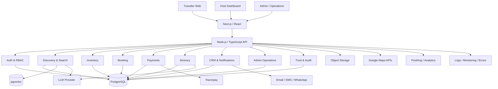
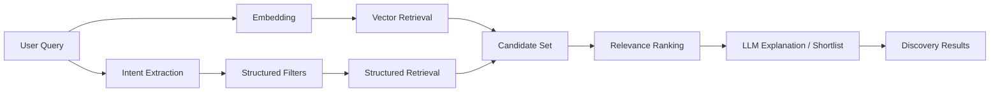
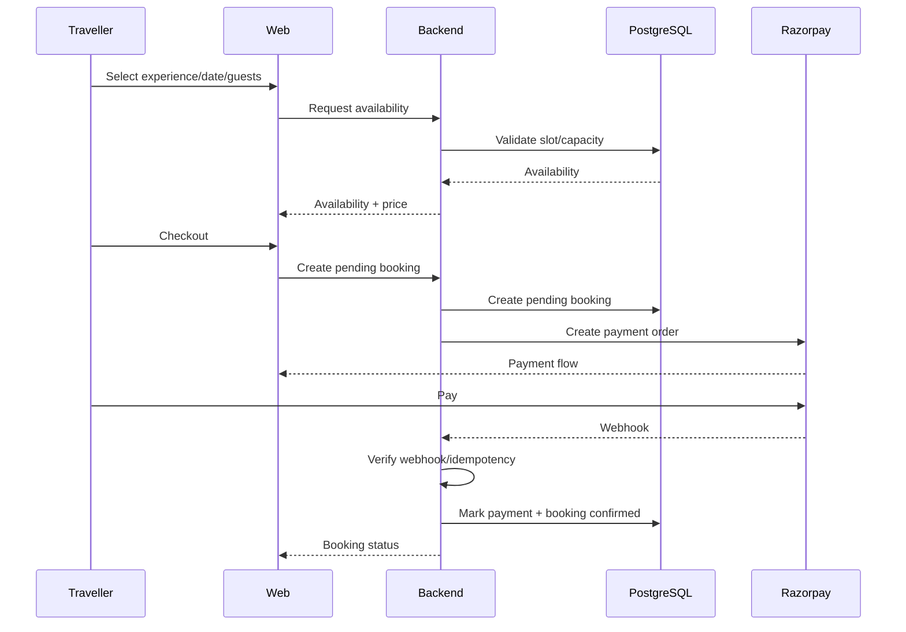

# La Vivenzia — System Design

## 1. Architecture Style

Initial architecture:

**Modular Monolith + API-first boundaries**

The system should have strong internal modules without forcing separate deployable microservices before scale requires them.

### Phase 1 topology

Decided in ADR-0002. One Next.js application on the Node runtime, serving both the UI and a versioned `/api/v1/*` REST surface, plus a **separate worker process built from the same codebase**. Two processes, one artifact, two start commands.

`System Design.png` shows a separate Node API service on ECS. That describes the Phase 2+ target, not the launch runtime; the diagram is a non-authoritative reference (ADR-0003).

The property that makes this reversible is a hard internal boundary: `src/modules` (domain logic) and `src/ports` (provider interfaces the domain owns) import nothing from Next.js, React, or any outward layer. This is enforced by lint, not convention. Extracting a standalone API service later is then a matter of writing new HTTP adapters over services that already exist.

The API is client-agnostic from day one — the web frontend consumes `/api/v1` exactly as a future mobile client will. There is no privileged internal path.

Extract the API service when a second first-class client ships, or when AI/search load demonstrably needs scaling independent of page rendering.

## 2. High-Level System



## 3. Frontend

Next.js + React + TypeScript.

Responsibilities:

- Rendering
- Routing
- Form UX
- Search UI
- Booking UI
- Host/admin dashboards
- Client-side interaction
- Calling backend APIs

The frontend must not own authoritative booking/payment decisions.

## 4. Backend Modules

```text
auth
users
travellers
hosts
verification
experiences
categories
locations
search
availability
bookings
payments
invoices
refunds
commissions
payouts
reviews
wishlists
itineraries
notifications
crm
analytics
admin
audit
```

## 5. Database

PostgreSQL is the system of record.

Use Prisma for database access.

Use pgvector for embedding/vector similarity where semantic discovery requires it.

### Extensions

Enabled from the foundation (ADR-0004), created by the initial migration so every environment is provisioned identically: `pgcrypto`, `citext`, `pg_trgm`, `postgis`, `vector`.

`postgis` is enabled from the start (ADR-0008) because FR-03 makes nearby and map-viewport discovery a launch requirement, and retrofitting a spatial column onto populated core tables is far more expensive than enabling the extension on an empty database.

`vector` is enabled but **no vector column exists yet**. The embedding provider is unresolved and it fixes the vector dimension (ADR-0007). No vector column may be added until that decision is made.

Full detail, including the RDS privilege requirement and schema conventions, is in `docs/DATABASE.md`.

## 6. Search Architecture



Rules:

- Structured filters remain deterministic.
- Vector retrieval provides semantic candidates.
- Ranking combines relevance, availability, quality and business rules.
- LLM output must not invent availability, pricing or booking state.

### What is built (ADR-0014)

The diagram above is the target. As of Phase 5.1 the **left and bottom paths are
real and the vector path is not**:

| Stage                | State                                                           |
| -------------------- | --------------------------------------------------------------- |
| Structured retrieval | Built — category, destination, price, duration, proximity        |
| Keyword retrieval    | Built — `ILIKE` plus `word_similarity` for misspellings          |
| Relevance ranking    | Built — weighted trigram similarity, `pg_trgm`                   |
| Proximity + distance | Built — `ST_DWithin` and `ST_Distance` on the PostGIS column     |
| Location + geocoding | Built — Google Places, with the catalogue as a live fallback     |
| Intent extraction    | Not built — Phase 8                                              |
| Embedding            | Not built — provider unresolved (ADR-0007, A-006)                |
| Vector retrieval     | Not built — no vector column exists, and none may be added yet   |
| LLM explanation      | Not built — Phase 8                                              |

Retrieval runs entirely in PostgreSQL. No search cluster, no vector database and
no cache tier were added; `PROJECT.md` §9 puts all three out of scope without
explicit approval, and nothing measured so far requires them.

**Search does not depend on any AI provider.** Every path above is deterministic
SQL. When the embedding and LLM stages land they add candidates and explanations
on top; if they are unavailable, search degrades to exactly what it does today
rather than failing. The same rule governs location: a maps outage falls back to
the cities in our own catalogue.

## 7. Booking Architecture



## 8. Payment Rules

- Never trust client payment success.
- Verify payment server-side.
- Process webhooks idempotently.
- Keep payment and booking state auditable.
- Refunds must update financial records.
- Reconciliation must be possible from internal records.

## 9. AI Architecture

AI should sit behind controlled application services.

```text
Application Request
      ↓
Business Rules
      ↓
Data Retrieval
      ↓
Context Builder
      ↓
LLM
      ↓
Structured Output Validation
      ↓
Business Rule Validation
      ↓
User Response
```

AI must not directly mutate critical financial or booking state.

## 10. External Integrations

Use adapter/service boundaries:

```text
/maps
/payments
/llm
/email
/messaging
/analytics
/storage
```

Provider-specific code should not spread throughout business modules.

## 11. Environments

```text
development
staging
production
```

Each environment must have separate configuration and credentials.

## 12. Security

- RBAC
- Input validation
- Rate limiting
- Secure cookies/tokens
- Encryption in transit
- Encryption at rest where supported
- Secrets management
- Audit logging
- Consent records
- Data retention/deletion
- Restricted API keys

## 13. Reliability

- Automated database backups
- Recovery plan
- Error monitoring
- Centralized logs
- Health checks
- Idempotent payment/webhook handlers
- Graceful failure for external APIs
- Timeouts and retries with limits

## 14. Background Jobs

Use asynchronous jobs only where appropriate:

- Email
- Notifications
- Invoice generation
- Media processing
- Analytics/event processing
- Non-critical AI tasks

### Mechanism

Background work runs on a **PostgreSQL-backed queue (pg-boss)**, not Redis. Decided in ADR-0001.

The reason is transactional consistency, not throughput. Nearly every job is caused by a database state change — booking confirmed, payment captured, refund processed. A queue in a separate system creates a dual-write problem in both directions: enqueue before commit and a rolled-back transaction still sends the email; commit before enqueue and the voucher is lost. A PostgreSQL queue lets the job be enqueued in the same transaction as the business write, so enqueue is exactly-once while delivery remains at-least-once.

Binding consequences for every job:

- **Handlers must be idempotent**, keyed on a business identifier — at-least-once delivery means every handler eventually runs twice.
- Bounded retries, exponential backoff, then a dead-letter state that is alarmed on. Background work must not fail silently.
- A job caused by a database write is enqueued inside that transaction, never by a call issued after commit.

### When to introduce Redis

Redis and BullMQ are **not** part of the launch architecture. `System Design.png` shows them because it describes the Phase 2+ target state; it is a non-authoritative reference (ADR-0003).

Introduce them when any of the following is observed, and not before:

- sustained throughput above ~50 jobs/sec;
- p95 queue latency above 30s under normal load;
- job tables exceeding ~5M live rows, or causing measurable vacuum pressure;
- a second independent need for Redis that CDN and PostgreSQL cannot meet.

Rate limiting is explicitly **not** such a need at launch: volumetric protection belongs at the edge (WAF), and the endpoints needing precise limits are low-volume enough for PostgreSQL counters.

## 15. Scaling Path

```text
Modular Monolith
      ↓
Caching / background jobs
      ↓
Dedicated search if justified
      ↓
Service extraction where justified
      ↓
Advanced cloud architecture
      ↓
Multi-region / global infrastructure
```
