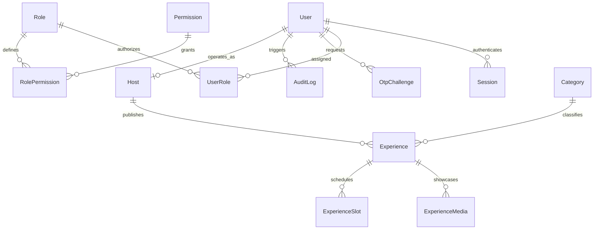
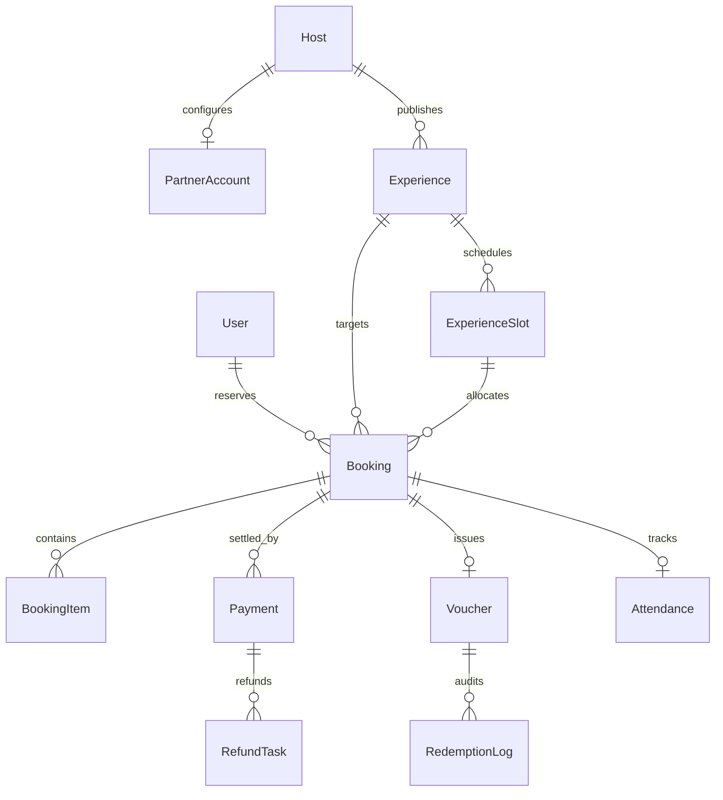

# LA-12 Sprint 1: Database Architecture, Prisma Schema & Migration Implementation

## Complete Technical Implementation Documentation

**Document ID:** `LV-DOC-LA12-SPRINT-1-TECHNICAL`  
**Repository:** `La-Vivenzia/lavivenzia-platform`  
**Initiative:** `LA-12` — Intermediate Host SaaS: Build Partner Portal & Connect Main SaaS to CRM  
**Milestone:** Pune Pilot MVP 2026 — Phase 2 Implementation  
**Sprint:** Sprint 1 — Database Architecture, Prisma Schema & Migration Implementation  
**Auditor / Author:** Senior Technical Documentation Engineer, Database Architect & Software Engineering Auditor  
**Date:** November 10, 2026  
**Status:** Approved at Schema, Model & Validation Tier (PostgreSQL Engine Migration Execution Pending/Unverified)

---

## 1. Executive Summary

### 1.1 Purpose of LA-12 Sprint 1

Prior to Sprint 1, the La Vivenzia Main SaaS platform (`lavivenzia-platform`) functioned exclusively as a discovery and exploration engine. Visitors could search, filter, and review experiential hospitality listings across Pune (e.g., luxury vineyard tours, rooftop mixology masterclasses, private supper clubs), but the platform lacked the relational database models, transaction records, and inventory reservation structures necessary to execute commercial bookings or process monetary payments.

The primary objective of **LA-12 Sprint 1** was to engineer, implement, and statically verify the complete relational database foundation supporting:

1. End-to-end customer checkout and reservation lifecycle management.
2. Gateway payment processing and webhook ingress via Razorpay.
3. Asynchronous outbox refund dispatching.
4. Cryptographically signed offline admission vouchers (Master Pass).
5. Physical door attendance and bouncer admission tracking.
6. Partner venue onboarding, commission configuration, and venue door security.

### 1.2 Business Capabilities Prepared by the Schema

Sprint 1 establishes the persistence layer that underpins the following business workflows:

- **Zero-Double-Booking Guarantee:** Establishing strict transactional boundaries, parent-child relational cascading, and seat-level accounting to prevent inventory overselling.
- **5-Minute Temporary Cart Hold:** Reserving seats temporarily during checkout with automatic dynamic release upon expiration.
- **Financial Traceability:** Recording every transaction, fee deduction, and refund task in integer minor units (paise) for reconciliation.
- **Offline Venue Admission:** Supporting QR pass redemption at nightclub/venue gates with asymmetric Ed25519 digital signatures and audit logging.
- **Ecosystem Convergence:** Providing the data bridge between the Main SaaS consumer marketplace, the Intermediate Host SaaS (`lavivenzia-host`), and Twenty CRM (`lavivenzia-crm`).

### 1.3 Implementation Completion & Approval Status

During Sprint 1, the following deliverables were implemented and verified:

- **9 Core Domain Models:** Appended to `prisma/schema.prisma`.
- **10 Domain & Policy Enums:** Defined and mapped to PostgreSQL snake_case types.
- **1 Consolidated DDL Migration Script:** Authored at `prisma/migrations/20261110140000_init_booking_and_payment_pipeline/migration.sql`.
- **21 Automated Vitest Unit Test Assertions:** Created in `tests/unit/phase2-schema-models.test.ts`.

### 1.4 Verification Tier Distinction & Production Disclaimer

To preserve strict engineering integrity, this document explicitly distinguishes between verified static/code-level checks and unverified runtime infrastructure:

| Verification Tier                  | Execution Command                                        | Result / Status                 | Notes                                                              |
| :--------------------------------- | :------------------------------------------------------- | :------------------------------ | :----------------------------------------------------------------- |
| **Prisma Schema Validation**       | `npx prisma validate`                                    | **PASSED (Exit Code 0)**        | AST schema syntax, relation parity, and enum mappings verified.    |
| **Prisma Client Generation**       | `npx prisma generate`                                    | **PASSED (Exit Code 0)**        | TypeScript client artifacts generated into `src/generated/prisma`. |
| **TypeScript Typecheck**           | `npm run typecheck` (`tsc --noEmit`)                     | **PASSED (Exit Code 0)**        | 0 TypeScript compilation errors across the entire codebase.        |
| **Sprint 1 Unit Test Suite**       | `npx vitest run tests/unit/phase2-schema-models.test.ts` | **PASSED (Exit Code 0)**        | 21 / 21 unit tests passed (10ms execution time).                   |
| **Full Platform Unit Suite**       | `npx vitest run tests/unit`                              | **PASSED (Exit Code 0)**        | 862 / 862 unit tests passed (47 test files, 0 regressions).        |
| **PostgreSQL 16 Engine Execution** | `npm run db:migrate` / `prisma migrate deploy`           | **PENDING / UNVERIFIED**        | No local PostgreSQL 16 server active on `localhost:5432`.          |
| **Production Deployment**          | Deployment to AWS RDS (`ap-south-1`)                     | **NOT EXECUTED / NOT APPROVED** | Production deployment has not occurred and is out of scope.        |

> [!WARNING]
> **Production Status Notice:** Sprint 1 is approved at the schema, model, and code-validation level. **PostgreSQL migration execution against a live database remains unverified.** Sprint 1 must NOT be characterized as deployed to staging or production environments until live migration execution is verified against a disposable PostgreSQL 16 container.

---

## 2. Sprint Objectives and Scope

### 2.1 In Scope

- Authoring the 9 domain models in `prisma/schema.prisma` adhering to the ratified Phase 1.8 state machine specification.
- Defining the 10 domain enums with explicit PostgreSQL snake_case mappings (`@@map`).
- Authoring production-ready PostgreSQL 16 migration DDL (`migration.sql`) including primary keys, foreign keys, unique constraints, B-Tree indexes, and CHECK constraints.
- Resolving historical state machine discrepancies regarding `BookingStatus` and `PaymentEvent` idempotency.
- Writing comprehensive unit tests in `tests/unit/phase2-schema-models.test.ts` to prevent schema regression.
- Running Prisma CLI validation, client generation, TypeScript compilation, and test execution.

### 2.2 Out of Scope (Deferred to Subsequent Sprints)

Sprint 1 establishes the **data architecture only**. The following functional capabilities are strictly out of scope:

- **Sprint 2:** `BookingCapacityEngine` service layer, `SELECT ... FOR UPDATE` row mutex locking, dynamic active-hold aggregation queries, and checkout reservation API endpoints (`POST /api/v1/checkout/hold`).
- **Sprint 3:** Razorpay Orders API client, payment signature verification middleware, and webhook route handler (`POST /api/v1/webhooks/razorpay`).
- **Sprint 4:** Asynchronous `RefundTask` outbox background worker dispatching to Razorpay Refunds API.
- **Sprint 5:** Ed25519 asymmetric cryptographic key generation, KMS voucher signing, and QR payload rendering.
- **Sprint 6:** Host SaaS door scanner application, offline camera scanner logic, and IndexedDB outbox synchronization.
- **Sprint 7:** Twenty CRM outbound webhook dispatcher and automatic partner onboarding provisioning.
- **Commercial Settlements:** Weekly CSV banking payout batch export and host ledger disbursements.

---

## 3. Existing Architecture Before Sprint 1

### 3.1 Baseline Relational Model (14 Models, 7 Enums)

Prior to Sprint 1, the `lavivenzia-platform` database schema consisted of 14 models and 7 enums established across six preceding migrations:



#### The 14 Baseline Models:

1. **`User` (`users`):** Platform core identity. Stores email, hashed passwords (Argon2id), phone number, and account lifecycle status.
2. **`Session` (`sessions`):** Server-side user sessions with token hashing, user-agent metadata, IP tracking, and expiry timestamps.
3. **`Role` (`roles`):** RBAC security role definition (e.g., `ROLE_TRAVELLER`, `ROLE_HOST`, `ROLE_ADMIN`, `ROLE_OPS`).
4. **`Permission` (`permissions`):** Fine-grained permission primitives granting discrete operational capabilities.
5. **`RolePermission` (`role_permissions`):** Many-to-many join table mapping permissions to roles.
6. **`UserRole` (`user_roles`):** Many-to-many join table binding users to roles.
7. **`AuditLog` (`audit_logs`):** Append-only compliance log capturing security-sensitive mutations with IP addresses and actor IDs.
8. **`OtpChallenge` (`otp_challenges`):** Cryptographic OTP verification challenges for passwordless login and multi-factor authentication.
9. **`RateLimitCounter` (`rate_limit_counters`):** Sliding-window rate limiter for brute-force defense on auth and API endpoints.
10. **`Host` (`hosts`):** Commercial partner profile. Stores legal entity details, business name, verification status, and operations reviewer notes.
11. **`Experience` (`experiences`):** Experiential tourism listing. Stores title, slug, summary, editorial descriptions, pricing structure, geographic location (PostGIS Point / geography), and operational status.
12. **`ExperienceMedia` (`experience_media`):** Media gallery assets associated with experiences. Tracks S3/R2 storage keys, MIME types, and display ordering.
13. **`Category` (`categories`):** Curated taxonomic categorization (e.g., "Culinary Journeys", "Nightlife VIP").
14. **`ExperienceSlot` (`experience_slots`):** Scheduled calendar occurrence for an experience.

#### The 7 Baseline Enums:

`UserStatus`, `RoleName`, `OtpPurpose`, `HostStatus`, `ExperienceStatus`, `PricingUnit`, `SlotStatus`.

### 3.2 Deep Dive: The `ExperienceSlot` Model

The `ExperienceSlot` entity is the anchor upon which the entire booking system depends:

```prisma
model ExperienceSlot {
  id           String @id @default(uuid()) @db.Uuid
  experienceId String @map("experience_id") @db.Uuid

  startsAt DateTime @map("starts_at") @db.Timestamptz(3)
  endsAt   DateTime @map("ends_at") @db.Timestamptz(3)

  capacity Int
  reservedCount Int @default(0) @map("reserved_count")
  bookingCutoffMinutes Int @default(0) @map("booking_cutoff_minutes")
  status SlotStatus @default(OPEN)

  createdAt DateTime @default(now()) @map("created_at") @db.Timestamptz(3)
  updatedAt DateTime @updatedAt @map("updated_at") @db.Timestamptz(3)

  experience Experience @relation(fields: [experienceId], references: [id], onDelete: Cascade)
  bookings   Booking[]

  @@unique([experienceId, startsAt])
  @@index([experienceId, startsAt])
  @@index([startsAt])
  @@map("experience_slots")
}
```

#### Critical Structural Realities:

- **Table Name Parity:** The database table is explicitly named **`experience_slots`** (mapped via `@@map("experience_slots")`). Requirements documents that colloquially refer to `AvailabilitySlot` map directly to `ExperienceSlot` in source code.
- **The Seat Ledger (`reservedCount`):** `reservedCount` represents **strictly confirmed reservations**. It is initialized to 0 and only increments upon successful payment capture (`BookingStatus.CONFIRMED`).
- **Database CHECK Constraint:** Migration `20261020191332_experience_availability_slots` established the database-level invariant:
  ```sql
  CONSTRAINT "experience_slots_reserved_within_capacity"
  CHECK ("reserved_count" >= 0 AND "reserved_count" <= "capacity")
  ```
- **Hold Dynamics:** Active temporary holds during checkout **never** increment or mutate `reservedCount`. Holds are calculated dynamically against `Booking` records where `status = 'HELD'` and `held_until > NOW()`.

---

## 4. Technology Stack and Database Conventions

### 4.1 Verified Project Toolchain Versions

| Component              | Pinned Version | Source of Verification                                 | Role                                        |
| :--------------------- | :------------- | :----------------------------------------------------- | :------------------------------------------ |
| **PostgreSQL**         | `16.x`         | `docker-compose.yml:17` (`lavivenzia/postgres-dev:16`) | Target production & dev database engine     |
| **Prisma ORM**         | `7.9.1`        | `package-lock.json` (`prisma@7.9.1`)                   | CLI schema validation & migration generator |
| **Prisma Client**      | `7.9.1`        | `package-lock.json` (`@prisma/client@7.9.1`)           | Type-safe query builder client              |
| **PostgreSQL Adapter** | `7.9.1`        | `package-lock.json` (`@prisma/adapter-pg@^7.9.1`)      | Direct driver adapter for Prisma Client     |
| **Node.js**            | `>=22.12`      | `package.json:7` (`engines.node`)                      | Runtime environment (Audited on v24.13.0)   |
| **TypeScript**         | `5.9.3`        | `package-lock.json` (`typescript@5.9.3`)               | Language and static type checking           |
| **Vitest**             | `4.1.11`       | `package-lock.json` (`vitest@^4.1.11`)                 | Unit and integration test runner            |
| **Next.js**            | `16.3.1`       | `package-lock.json` (`next@^16.3.1`)                   | Full-stack web application framework        |

### 4.2 Prisma 7 Architecture & `prisma.config.ts`

Prisma 7 removed automatic environment variable loading from `.env` files within the CLI. To ensure deterministic local development, migration execution, and CI verification, configuration is managed in `prisma.config.ts`:

- Loads `.env.local` followed by `.env` via native `process.loadEnvFile`.
- Reads `DIRECT_DATABASE_URL` (direct unpooled connection) for migrations, falling back to `DATABASE_URL`.
- Configures `SHADOW_DATABASE_URL` for `prisma migrate diff` replay verification.
- Points seed execution to `tsx prisma/seed.ts`.

### 4.3 Database Engineering Conventions

#### 1. Primary Keys & UUIDs

All primary keys use version-4 UUIDs generated via PostgreSQL native functions:

```prisma
id String @id @default(uuid()) @db.Uuid
```

In PostgreSQL DDL, this compiles to `UUID NOT NULL PRIMARY KEY DEFAULT gen_random_uuid()`. The sole exception is `RedemptionLog`, which employs a 64-bit monotonically increasing `BigInt` (`BIGSERIAL`) to maintain strict sequential audit order.

#### 2. Temporal Fields (Timestamps)

All timestamps are persisted as microsecond-precision UTC timestamps with timezone:

```prisma
createdAt DateTime @default(now()) @map("created_at") @db.Timestamptz(3)
```

This maps to PostgreSQL `TIMESTAMPTZ(3)`.

#### 3. Monetary Amounts in Integer Minor Units

To eliminate floating-point arithmetic rounding errors and comply with payment gateway specifications (Razorpay), all monetary values are stored as integers representing minor currency units (paise for INR, where ₹1.00 = 100 paise):

- `Booking.totalAmountMinorUnits`
- `BookingItem.unitPriceMinorUnits`
- `BookingItem.totalPriceMinorUnits`
- `Payment.amountMinorUnits`
- `Payment.refundedAmountMinorUnits`
- `Payment.feeMinorUnits`
- `Payment.taxMinorUnits`
- `RefundTask.amountMinorUnits`

#### 4. Naming Conventions & Schema Mapping

Prisma models and attributes use TypeScript idiomatic camelCase, mapped strictly to PostgreSQL snake_case table and column identifiers via `@map(...)` and `@@map(...)`.

---

## 5. New Database Enums

Sprint 1 defines 10 discrete enums to support the domain lifecycles:

| #   | Prisma Enum            | PostgreSQL Type          | Allowed Values                                                                                                        | Model Usage                | Business Responsibility                                                     |
| --- | :--------------------- | :----------------------- | :-------------------------------------------------------------------------------------------------------------------- | :------------------------- | :-------------------------------------------------------------------------- |
| 1   | `BookingStatus`        | `booking_status`         | `DRAFT`, `HELD`, `CONFIRMED`, `CANCELLED`, `EXPIRED`, `EXPIRED_UNFULFILLED`                                           | `Booking`                  | Tracks commercial reservation contract. `CHECKED_IN` is strictly forbidden. |
| 2   | `PaymentStatus`        | `payment_status`         | `CREATED`, `INITIATED`, `INITIATED_UNCERTAIN`, `AUTHORIZED`, `CAPTURED`, `FAILED`, `REFUNDED`, `RECONCILED_ABANDONED` | `Payment`                  | Tracks monetary ingress via Razorpay.                                       |
| 3   | `RefundStatus`         | `refund_status`          | `NONE`, `PENDING`, `PROCESSING`, `PROCESSING_UNCERTAIN`, `PROCESSED`, `FAILED`, `MANUAL_RECONCILIATION_REQUIRED`      | `Payment`                  | Outbox settlement state for payment reversals.                              |
| 4   | `VoucherStatus`        | `voucher_status`         | `ISSUED`, `PROVISIONAL`, `REDEEMED`, `CONFLICT`, `REJECTED`, `EXPIRED`, `REVOKED`                                     | `Voucher`, `RedemptionLog` | Cryptographic Master Pass credential lifecycle.                             |
| 5   | `AttendanceStatus`     | `attendance_status`      | `NOT_ARRIVED`, `ATTENDED`, `NO_SHOW`                                                                                  | `Attendance`               | Physical door arrival and venue presence.                                   |
| 6   | `PaymentEventStatus`   | `payment_event_status`   | `RECEIVED`, `PROCESSED`, `DUPLICATE_IGNORED`, `FAILED`                                                                | `PaymentEvent`             | Webhook ingestion and deduplication status.                                 |
| 7   | `RefundTaskStatus`     | `refund_task_status`     | `PENDING`, `PROCESSING`, `COMPLETED`, `FAILED`, `MANUAL_REVIEW`                                                       | `RefundTask`               | Outbox worker job lifecycle for refunds.                                    |
| 8   | `PartnerAccountStatus` | `partner_account_status` | `INVITED`, `PENDING_ACTIVATION`, `ACTIVE`, `SUSPENDED`, `TERMINATED`                                                  | `PartnerAccount`           | Venue partner portal operational status.                                    |
| 9   | `FeeAbsorptionPolicy`  | `fee_absorption_policy`  | `PLATFORM_ABSORBS`, `PARTNER_DEDUCTED`                                                                                | `PartnerAccount`           | Payment processing fee liability allocation (ADR A-004).                    |
| 10  | `PayoutMethod`         | `payout_method`          | `MANUAL_CSV`, `RAZORPAY_ROUTE`                                                                                        | `PartnerAccount`           | Weekly financial settlement disbursement protocol (ADR A-005).              |

### Strict Invariant: Prohibition of `CHECKED_IN` in `BookingStatus`

A primary governance rectification of Phase 1.8 was eliminating `CHECKED_IN` from `BookingStatus`. The commercial booking represents a legal contract and capacity claim against an inventory slot. Once paid, its terminal valid state is `CONFIRMED`. Physical admission at the door mutates `Voucher.status ➔ REDEEMED` and `Attendance.status ➔ ATTENDED`. The `Booking` record remains `CONFIRMED`.

---

## 6. New Database Models — Detailed Explanation

### 6.1 `Booking` (`bookings`)

- **Purpose:** System of record for inventory reservations and commercial checkout contracts.
- **Business Responsibility:** Manages the 5-minute capacity hold during checkout, links travellers to scheduled slots, and tracks confirmation timestamps.
- **Fields Table:**

| Field                   | Data Type        | Nullable |       Default       | Description                                          |
| :---------------------- | :--------------- | :------: | :-----------------: | :--------------------------------------------------- |
| `id`                    | `UUID`           |    No    | `gen_random_uuid()` | Primary key.                                         |
| `bookingReference`      | `String`         |    No    |       _None_        | Unique human-readable code (e.g. `LV-PN-2026-X89K`). |
| `userId`                | `UUID`           |    No    |       _None_        | Foreign key to `users.id`.                           |
| `experienceId`          | `UUID`           |    No    |       _None_        | Foreign key to `experiences.id`.                     |
| `slotId`                | `UUID`           |    No    |       _None_        | Foreign key to `experience_slots.id`.                |
| `guestCount`            | `Int`            |    No    |       _None_        | Number of guests in party (must be $\ge 1$).         |
| `status`                | `BookingStatus`  |    No    |       `DRAFT`       | Current lifecycle state.                             |
| `heldUntil`             | `TIMESTAMPTZ(3)` |   Yes    |       _None_        | Expiration timestamp for the 5-minute hold.          |
| `totalAmountMinorUnits` | `Int`            |    No    |       _None_        | Total payable amount in paise (must be $\ge 0$).     |
| `currency`              | `String`         |    No    |       `'INR'`       | ISO 4217 currency code.                              |
| `customerEmail`         | `CITEXT`         |   Yes    |       _None_        | Case-insensitive guest contact email.                |
| `customerPhone`         | `String`         |   Yes    |       _None_        | Contact phone number for SMS/WhatsApp pass delivery. |
| `specialRequests`       | `String`         |   Yes    |       _None_        | Dietary or accessibility requirements.               |
| `confirmedAt`           | `TIMESTAMPTZ(3)` |   Yes    |       _None_        | Instant when payment was confirmed.                  |
| `cancelledAt`           | `TIMESTAMPTZ(3)` |   Yes    |       _None_        | Instant when booking was cancelled.                  |
| `cancellationReason`    | `String`         |   Yes    |       _None_        | Reason recorded for cancellation.                    |
| `createdAt`             | `TIMESTAMPTZ(3)` |    No    |       `NOW()`       | Record creation timestamp.                           |
| `updatedAt`             | `TIMESTAMPTZ(3)` |    No    |       _Auto_        | Record update timestamp.                             |

- **Relationships:**
  - `user`: Belongs to one `User` (`ON DELETE RESTRICT`).
  - `experience`: Belongs to one `Experience` (`ON DELETE RESTRICT`).
  - `slot`: Belongs to one `ExperienceSlot` (`ON DELETE RESTRICT`).
  - `items`: Has many `BookingItem` records (`ON DELETE CASCADE`).
  - `payments`: Has many `Payment` records (`ON DELETE RESTRICT`).
  - `voucher`: Has one optional `Voucher` (`ON DELETE RESTRICT`).
  - `attendance`: Has one optional `Attendance` (`ON DELETE RESTRICT`).
- **Constraints & Indexes:**
  - Unique: `bookingReference`.
  - Indexes: `[userId, status]`, `[slotId, status, heldUntil]`, `[experienceId, status]`, `[status, heldUntil]`.
  - CHECK: `guest_count >= 1`, `total_amount_minor_units >= 0`.
- **Example Record Purpose:** Represents a customer reserving 2 seats for the "Sunset Vineyard Tasting" on November 15, holding seats for 5 minutes during Razorpay checkout.

---

### 6.2 `BookingItem` (`booking_items`)

- **Purpose:** Itemized financial breakdown of a reservation.
- **Business Responsibility:** Supports multi-tier pricing, group rates, VIP add-ons, and beverage packages under a single booking.
- **Fields Table:**

| Field                  | Data Type        | Nullable |       Default       | Description                                         |
| :--------------------- | :--------------- | :------: | :-----------------: | :-------------------------------------------------- |
| `id`                   | `UUID`           |    No    | `gen_random_uuid()` | Primary key.                                        |
| `bookingId`            | `UUID`           |    No    |       _None_        | Foreign key to `bookings.id`.                       |
| `title`                | `String`         |    No    |       _None_        | Itemized label (e.g. "General Admission Ticket").   |
| `quantity`             | `Int`            |    No    |         `1`         | Number of units purchased (must be $\ge 1$).        |
| `unitPriceMinorUnits`  | `Int`            |    No    |       _None_        | Per-unit price in paise.                            |
| `totalPriceMinorUnits` | `Int`            |    No    |       _None_        | Total line price in paise (`unitPrice * quantity`). |
| `createdAt`            | `TIMESTAMPTZ(3)` |    No    |       `NOW()`       | Record creation timestamp.                          |

- **Relationships:** Belongs to `Booking` (`ON DELETE CASCADE`).
- **Constraints & Indexes:** Index on `[bookingId]`. CHECK: `quantity >= 1`.
- **Example Record Purpose:** Itemizes 2 $\times$ ₹2,500 General Admission tickets ($\text{₹}5,000 = 500,000 \text{ paise}$).

---

### 6.3 `Payment` (`payments`)

- **Purpose:** Ingress financial ledger tracking transactions processed through Razorpay.
- **Business Responsibility:** Records gateway order IDs, payment IDs, HMAC signatures, authorized amounts, captured fees, and demo simulations.
- **Fields Table:**

| Field                      | Data Type        | Nullable |       Default       | Description                                   |
| :------------------------- | :--------------- | :------: | :-----------------: | :-------------------------------------------- |
| `id`                       | `UUID`           |    No    | `gen_random_uuid()` | Primary key.                                  |
| `bookingId`                | `UUID`           |    No    |       _None_        | Foreign key to `bookings.id`.                 |
| `razorpayOrderId`          | `String`         |   Yes    |       _None_        | Razorpay order ID (`order_...`). Unique.      |
| `razorpayPaymentId`        | `String`         |   Yes    |       _None_        | Razorpay payment ID (`pay_...`). Unique.      |
| `razorpaySignature`        | `String`         |   Yes    |       _None_        | HMAC-SHA256 signature string.                 |
| `amountMinorUnits`         | `Int`            |    No    |       _None_        | Total authorized/captured amount in paise.    |
| `currency`                 | `String`         |    No    |       `'INR'`       | Currency code.                                |
| `status`                   | `PaymentStatus`  |    No    |      `CREATED`      | Ingress payment state.                        |
| `refundStatus`             | `RefundStatus`   |    No    |       `NONE`        | Settlement refund status.                     |
| `refundedAmountMinorUnits` | `Int`            |    No    |         `0`         | Cumulative amount refunded in paise.          |
| `isSimulated`              | `Boolean`        |    No    |       `false`       | True for Admin Demo checkout (ADR A-006).     |
| `method`                   | `String`         |   Yes    |       _None_        | Payment method (`card`, `upi`, `netbanking`). |
| `bank`                     | `String`         |   Yes    |       _None_        | Bank code for netbanking.                     |
| `wallet`                   | `String`         |   Yes    |       _None_        | Wallet provider code.                         |
| `vpa`                      | `String`         |   Yes    |       _None_        | Virtual Payment Address for UPI.              |
| `feeMinorUnits`            | `Int`            |   Yes    |       _None_        | Gateway processing fee in paise.              |
| `taxMinorUnits`            | `Int`            |   Yes    |       _None_        | Goods and Services Tax on fee in paise.       |
| `errorCode`                | `String`         |   Yes    |       _None_        | Error code returned by gateway on failure.    |
| `errorDescription`         | `String`         |   Yes    |       _None_        | Human-readable gateway error message.         |
| `capturedAt`               | `TIMESTAMPTZ(3)` |   Yes    |       _None_        | Instant payment was captured.                 |
| `createdAt`                | `TIMESTAMPTZ(3)` |    No    |       `NOW()`       | Record creation timestamp.                    |
| `updatedAt`                | `TIMESTAMPTZ(3)` |    No    |       _Auto_        | Record update timestamp.                      |

- **Relationships:**
  - `booking`: Belongs to `Booking` (`ON DELETE RESTRICT`).
  - `refundTasks`: Has many `RefundTask` records (`ON DELETE RESTRICT`).
- **Constraints & Indexes:**
  - Unique: `razorpayOrderId`, `razorpayPaymentId`.
  - Indexes: `[bookingId]`, `[status]`, `[refundStatus]`.
  - CHECK: `refunded_amount_minor_units >= 0 AND refunded_amount_minor_units <= amount_minor_units`.
- **Example Record Purpose:** Records a captured payment of ₹5,000 via UPI ID `customer@okaxis` for booking `LV-PN-2026-X89K`.

---

### 6.4 `PaymentEvent` (`payment_events`)

- **Purpose:** Idempotent ingress event log for all incoming Razorpay webhooks.
- **Business Responsibility:** Guarantees that duplicate webhook deliveries from Razorpay cannot trigger duplicate state transitions or double-fulfill orders.
- **Fields Table:**

| Field          | Data Type            | Nullable |       Default       | Description                                               |
| :------------- | :------------------- | :------: | :-----------------: | :-------------------------------------------------------- |
| `id`           | `UUID`               |    No    | `gen_random_uuid()` | Primary key.                                              |
| `eventId`      | `String`             |    No    |       _None_        | Unique event ID from Razorpay (`X-Razorpay-Event-Id`).    |
| `eventType`    | `String`             |    No    |       _None_        | Event name (e.g. `payment.captured`, `refund.processed`). |
| `orderId`      | `String`             |   Yes    |       _None_        | Gateway order ID referenced in payload.                   |
| `paymentId`    | `String`             |   Yes    |       _None_        | Gateway payment ID referenced in payload.                 |
| `payload`      | `JSONB`              |    No    |       _None_        | Raw JSON webhook payload received.                        |
| `status`       | `PaymentEventStatus` |    No    |     `RECEIVED`      | Processing status.                                        |
| `errorMessage` | `String`             |   Yes    |       _None_        | Error message if processing failed.                       |
| `processedAt`  | `TIMESTAMPTZ(3)`     |   Yes    |       _None_        | Instant processing finished.                              |
| `createdAt`    | `TIMESTAMPTZ(3)`     |    No    |       `NOW()`       | Ingress receipt timestamp.                                |

- **Constraints & Indexes:**
  - Unique: `eventId` (Enforces idempotency).
  - Indexes: `[eventType]`, `[status]`, `[orderId]`, `[paymentId]`.
- **Example Record Purpose:** Stores the raw `payment.captured` JSON payload with unique event ID `evt_1234567890`.

---

### 6.5 `RefundTask` (`refund_tasks`)

- **Purpose:** Asynchronous transactional outbox table for issuing refunds.
- **Business Responsibility:** Decouples refund requests (e.g., late payments on sold-out slots or admin cancellations) from synchronous HTTP calls to Razorpay.
- **Fields Table:**

| Field              | Data Type          | Nullable |       Default       | Description                                       |
| :----------------- | :----------------- | :------: | :-----------------: | :------------------------------------------------ |
| `id`               | `UUID`             |    No    | `gen_random_uuid()` | Primary key.                                      |
| `paymentId`        | `UUID`             |    No    |       _None_        | Foreign key to `payments.id`.                     |
| `amountMinorUnits` | `Int`              |    No    |       _None_        | Refund amount in paise.                           |
| `currency`         | `String`           |    No    |       `'INR'`       | Currency code.                                    |
| `reason`           | `String`           |    No    |       _None_        | Business reason for refund.                       |
| `status`           | `RefundTaskStatus` |    No    |      `PENDING`      | Outbox worker task state.                         |
| `attempts`         | `Int`              |    No    |         `0`         | Number of dispatch attempts executed.             |
| `maxAttempts`      | `Int`              |    No    |         `5`         | Maximum retry attempts before operator review.    |
| `nextAttemptAt`    | `TIMESTAMPTZ(3)`   |   Yes    |       _None_        | Scheduled execution time for exponential backoff. |
| `razorpayRefundId` | `String`           |   Yes    |       _None_        | Gateway refund ID (`rfnd_...`). Unique.           |
| `lastError`        | `String`           |   Yes    |       _None_        | Error description from previous failed dispatch.  |
| `processedAt`      | `TIMESTAMPTZ(3)`   |   Yes    |       _None_        | Instant refund was confirmed by gateway.          |
| `createdAt`        | `TIMESTAMPTZ(3)`   |    No    |       `NOW()`       | Queue creation timestamp.                         |
| `updatedAt`        | `TIMESTAMPTZ(3)`   |    No    |       _Auto_        | Record update timestamp.                          |

- **Relationships:** Belongs to `Payment` (`ON DELETE RESTRICT`).
- **Constraints & Indexes:**
  - Unique: `razorpayRefundId`.
  - Indexes: `[paymentId]`, `[status, nextAttemptAt]`.
  - CHECK: `amount_minor_units >= 1`.
- **Example Record Purpose:** Queues a ₹5,000 refund because payment arrived after the 5-minute hold expired and the slot had sold out.

---

### 6.6 `Voucher` (`vouchers`)

- **Purpose:** Digital Master Pass credential presented by the customer at the venue door.
- **Business Responsibility:** Holds asymmetric Ed25519 cryptographic signatures for offline door scanning, preventing ticket tampering and replay attacks.
- **Fields Table:**

| Field              | Data Type        | Nullable |       Default       | Description                                             |
| :----------------- | :--------------- | :------: | :-----------------: | :------------------------------------------------------ |
| `id`               | `UUID`           |    No    | `gen_random_uuid()` | Primary key.                                            |
| `bookingId`        | `UUID`           |    No    |       _None_        | Foreign key to `bookings.id`. Unique (1-to-1).          |
| `keyId`            | `String`         |    No    |       _None_        | Identifier of KMS public key used for verification.     |
| `qrPayload`        | `TEXT`           |    No    |       _None_        | Serialized string encoded inside QR code.               |
| `signature`        | `String`         |    No    |       _None_        | Base64-encoded Ed25519 digital signature.               |
| `status`           | `VoucherStatus`  |    No    |      `ISSUED`       | Bearer pass status.                                     |
| `issuedAt`         | `TIMESTAMPTZ(3)` |    No    |       `NOW()`       | Issuance timestamp.                                     |
| `expiresAt`        | `TIMESTAMPTZ(3)` |    No    |       _None_        | Validity expiration (experience slot end time + grace). |
| `redeemedAt`       | `TIMESTAMPTZ(3)` |   Yes    |       _None_        | Central backend redemption timestamp.                   |
| `revokedAt`        | `TIMESTAMPTZ(3)` |   Yes    |       _None_        | Revocation timestamp.                                   |
| `revocationReason` | `String`         |   Yes    |       _None_        | Operational reason for pass revocation.                 |
| `createdAt`        | `TIMESTAMPTZ(3)` |    No    |       `NOW()`       | Record creation timestamp.                              |
| `updatedAt`        | `TIMESTAMPTZ(3)` |    No    |       _Auto_        | Record update timestamp.                                |

- **Relationships:**
  - `booking`: Belongs to one `Booking` (`ON DELETE RESTRICT`).
  - `redemptionLogs`: Has many `RedemptionLog` records (`ON DELETE RESTRICT`).
- **Constraints & Indexes:**
  - Unique: `bookingId`.
  - Indexes: `[status]`, `[expiresAt]`, `[keyId]`.
- **Example Record Purpose:** Holds the signed Ed25519 QR pass allowing a party of 2 to enter a nightclub on Friday night.

---

### 6.7 `Attendance` (`attendances`)

- **Purpose:** Physical venue door admission tracking.
- **Business Responsibility:** Decouples physical check-in and no-show operations from commercial booking state.
- **Fields Table:**

| Field            | Data Type          | Nullable |       Default       | Description                                                 |
| :--------------- | :----------------- | :------: | :-----------------: | :---------------------------------------------------------- |
| `id`             | `UUID`             |    No    | `gen_random_uuid()` | Primary key.                                                |
| `bookingId`      | `UUID`             |    No    |       _None_        | Foreign key to `bookings.id`. Unique (1-to-1).              |
| `status`         | `AttendanceStatus` |    No    |    `NOT_ARRIVED`    | Physical presence state.                                    |
| `guestCount`     | `Int`              |    No    |       _None_        | Expected party size (must match booking).                   |
| `attendedAt`     | `TIMESTAMPTZ(3)`   |   Yes    |       _None_        | Instant party was admitted at the gate.                     |
| `noShowMarkedAt` | `TIMESTAMPTZ(3)`   |   Yes    |       _None_        | Instant party was marked as no-show.                        |
| `noShowMarkedBy` | `UUID`             |   Yes    |       _None_        | User ID of host manager marking no-show.                    |
| `notes`          | `String`           |   Yes    |       _None_        | Door notes (e.g. "Admitted 2 guests, dress code verified"). |
| `createdAt`      | `TIMESTAMPTZ(3)`   |    No    |       `NOW()`       | Record creation timestamp.                                  |
| `updatedAt`      | `TIMESTAMPTZ(3)`   |    No    |       _Auto_        | Record update timestamp.                                    |

- **Relationships:** Belongs to one `Booking` (`ON DELETE RESTRICT`).
- **Constraints & Indexes:**
  - Unique: `bookingId`.
  - Indexes: `[status]`, `[attendedAt]`.
  - CHECK: `guest_count >= 1`.
- **Example Record Purpose:** Displays on the Host Roster (`/host/roster/[slotId]`) showing that the customer party has arrived at 21:15 IST and was admitted.

---

### 6.8 `RedemptionLog` (`redemption_logs`)

- **Purpose:** Append-only cryptographic and operational audit ledger.
- **Business Responsibility:** Records every voucher redemption attempt, scanner device ID, offline sync event, and scan rejection.
- **Fields Table:**

| Field              | Data Type        | Nullable |      Default      | Description                                          |
| :----------------- | :--------------- | :------: | :---------------: | :--------------------------------------------------- |
| `id`               | `BigInt`         |    No    | `autoincrement()` | Monotonic 64-bit sequence primary key (`BIGSERIAL`). |
| `voucherId`        | `UUID`           |    No    |      _None_       | Foreign key to `vouchers.id`.                        |
| `scannerUserId`    | `UUID`           |   Yes    |      _None_       | ID of staff member operating the scanner.            |
| `deviceId`         | `String`         |   Yes    |      _None_       | Unique hardware fingerprint of mobile device.        |
| `ipAddress`        | `INET`           |   Yes    |      _None_       | Client IP address at time of sync.                   |
| `userAgent`        | `String`         |   Yes    |      _None_       | Browser or native app user agent string.             |
| `isOfflineSync`    | `Boolean`        |    No    |      `false`      | True if redemption was cached offline before sync.   |
| `offlineScannedAt` | `TIMESTAMPTZ(3)` |   Yes    |      _None_       | Local device timestamp of offline scan.              |
| `syncedAt`         | `TIMESTAMPTZ(3)` |    No    |      `NOW()`      | Central database commit timestamp.                   |
| `resultStatus`     | `VoucherStatus`  |    No    |      _None_       | Outcome of scan (`REDEEMED`, `CONFLICT`, etc.).      |
| `rawPayload`       | `TEXT`           |   Yes    |      _None_       | Raw scan data string.                                |
| `failureReason`    | `String`         |   Yes    |      _None_       | Rejection diagnostic reason.                         |

- **Relationships:** Belongs to `Voucher` (`ON DELETE RESTRICT`).
- **Constraints & Indexes:** Indexes: `[voucherId, syncedAt]`, `[syncedAt]`, `[resultStatus]`.
- **Example Record Purpose:** Logs that Bouncer Phone #2 scanned Voucher `v-987` at 22:04 IST while offline, synced at 22:15 IST with result `REDEEMED`.

---

### 6.9 `PartnerAccount` (`partner_accounts`)

- **Purpose:** Commercial and operational account extension for venue hosts.
- **Business Responsibility:** Connects the Main SaaS `Host` entity to Twenty CRM, configures commission rates, and manages Door PIN security (ADR A-002, A-003, A-007).
- **Fields Table:**

| Field                   | Data Type              | Nullable |       Default        | Description                                          |
| :---------------------- | :--------------------- | :------: | :------------------: | :--------------------------------------------------- |
| `id`                    | `UUID`                 |    No    | `gen_random_uuid()`  | Primary key.                                         |
| `hostId`                | `UUID`                 |    No    |        _None_        | Foreign key to `hosts.id`. Unique (1-to-1).          |
| `crmPartnerId`          | `String`               |   Yes    |        _None_        | Foreign ID in Twenty CRM (`lvPartner`). Unique.      |
| `commissionBps`         | `Int`                  |    No    |        `1500`        | Commission basis points (1500 = 15.00%, ADR A-003).  |
| `feeAbsorptionPolicy`   | `FeeAbsorptionPolicy`  |    No    |  `PLATFORM_ABSORBS`  | Gateway fee liability (ADR A-004).                   |
| `payoutMethod`          | `PayoutMethod`         |    No    |     `MANUAL_CSV`     | Payout mechanism (ADR A-005).                        |
| `status`                | `PartnerAccountStatus` |    No    | `PENDING_ACTIVATION` | Portal account lifecycle state.                      |
| `bankAccountNumber`     | `String`               |   Yes    |        _None_        | Partner bank account number.                         |
| `bankIfscCode`          | `String`               |   Yes    |        _None_        | Indian Financial System Code for NEFT/RTGS.          |
| `bankBeneficiaryName`   | `String`               |   Yes    |        _None_        | Legal payee name.                                    |
| `doorPinHash`           | `String`               |   Yes    |        _None_        | Argon2id hash of 4-digit Venue Door PIN (ADR A-007). |
| `doorPinFailedAttempts` | `Int`                  |    No    |         `0`          | Consecutive failed PIN attempts counter.             |
| `doorPinLockedUntil`    | `TIMESTAMPTZ(3)`       |   Yes    |        _None_        | Lockout timestamp after 5 failed attempts.           |
| `invitationTokenHash`   | `String`               |   Yes    |        _None_        | SHA-256 hash of onboarding invite token (ADR A-002). |
| `invitationExpiresAt`   | `TIMESTAMPTZ(3)`       |   Yes    |        _None_        | Expiration timestamp of invite token.                |
| `invitationAcceptedAt`  | `TIMESTAMPTZ(3)`       |   Yes    |        _None_        | Instant invitation was redeemed.                     |
| `activatedAt`           | `TIMESTAMPTZ(3)`       |   Yes    |        _None_        | Instant portal account became active.                |
| `suspendedAt`           | `TIMESTAMPTZ(3)`       |   Yes    |        _None_        | Suspension timestamp.                                |
| `suspensionReason`      | `String`               |   Yes    |        _None_        | Operational reason for suspension.                   |
| `createdAt`             | `TIMESTAMPTZ(3)`       |    No    |       `NOW()`        | Record creation timestamp.                           |
| `updatedAt`             | `TIMESTAMPTZ(3)`       |    No    |        _Auto_        | Record update timestamp.                             |

- **Relationships:** Belongs to `Host` (`ON DELETE CASCADE`).
- **Constraints & Indexes:**
  - Unique: `hostId`, `crmPartnerId`, `invitationTokenHash`.
  - Indexes: `[status]`.
  - CHECK: `commission_bps >= 0 AND commission_bps <= 10000`.
- **Example Record Purpose:** Stores venue settings for "The Pune Sky Lounge", setting commission to 15% and locking door staff scanning if 5 incorrect PINs are entered.

---

## 7. Five Independent Domain State Machines

Sprint 1 codifies the separation of concerns across five orthogonal state machines:

```mermaid
flowchart TD
    subgraph BookingDomain["1. Booking Domain (Commercial Inventory)"]
        b1[DRAFT] -->|Hold Acquired| b2[HELD]
        b2 -->|Payment Captured| b3[CONFIRMED]
        b2 -->|TTL 5m Elapsed| b4[EXPIRED]
        b2 -->|User Aborts| b5[CANCELLED]
        b4 -->|Late Webhook + Sold Out| b6[EXPIRED_UNFULFILLED]
    end

    subgraph PaymentDomain["2. Payment Domain (Gateway Ingress)"]
        p1[CREATED] -->|Order Dispatched| p2[INITIATED]
        p2 -->|Network Timeout >8s| p3[INITIATED_UNCERTAIN]
        p2 -->|Customer Paid| p4[CAPTURED]
        p2 -->|Declined / Aborted| p5[FAILED]
        p4 -->|100% Refund Confirmed| p6[REFUNDED]
    end

    subgraph RefundDomain["3. Refund Domain (Outbox Settlement)"]
        r1[NONE] -->|Refund Queued| r2[PENDING]
        r2 -->|Worker Call Sent| r3[PROCESSING]
        r3 -->|Gateway Webhook| r4[PROCESSED]
        r3 -->|Gateway Rejection| r5[FAILED]
    end

    subgraph VoucherDomain["4. Voucher Domain (Cryptographic Bearer Pass)"]
        v1[ISSUED] -->|Offline Door Scan| v2[PROVISIONAL]
        v1 -->|Online Door Scan| v3[REDEEMED]
        v2 -->|Reconnection Sync| v3
        v2 -->|Double Scan Detected| v4[CONFLICT]
    end

    subgraph AttendanceDomain["5. Attendance Domain (Door Arrival)"]
        a1[NOT_ARRIVED] -->|Voucher Redeemed| a2[ATTENDED]
        a1 -->|Slot Elapsed / Host Toggle| a3[NO_SHOW]
    end
```



### 7.1 Domain 1: Booking State Machine (`Booking.status`)

- **`DRAFT`:** Cart session created; party size selected. Zero claim on slot capacity.
- **`HELD`:** 5-minute atomic hold acquired. Counted dynamically in SQL via `status = 'HELD' AND held_until > NOW()`.
- **`CONFIRMED`:** Payment verified. Capacity permanently committed to `ExperienceSlot.reservedCount`. Terminal confirmed state. **Does NOT transition on check-in.**
- **`CANCELLED`:** Reservation cancelled by customer or host before operational cutoff.
- **`EXPIRED`:** 5-minute TTL elapsed without payment capture. Drops out of dynamic hold count.
- **`EXPIRED_UNFULFILLED`:** Edge case where a delayed payment capture arrives for an expired hold, but the slot has already sold out. Capacity cannot be allocated; triggers automated full refund.

### 7.2 Domain 2: Payment State Machine (`Payment.status`)

- **`CREATED`:** Internal payment record generated inside DB transaction prior to gateway call.
- **`INITIATED`:** Gateway order created (`order_id` assigned).
- **`INITIATED_UNCERTAIN`:** Network timeout (>8,000ms) during order creation. Blind retries are strictly prohibited; requires spaced polling or webhook recovery.
- **`AUTHORIZED`:** Authorized on gateway; awaiting capture.
- **`CAPTURED`:** Funds successfully collected from customer.
- **`FAILED`:** Transaction declined, aborted, or expired.
- **`REFUNDED`:** 100% of captured funds returned to customer.
- **`RECONCILED_ABANDONED`:** Sweeper marked abandoned order expired after payment window closed.

### 7.3 Domain 3: Refund State Machine (`Payment.refundStatus`)

- **`NONE`:** Standard active payment.
- **`PENDING`:** Refund task queued in `RefundTask` outbox.
- **`PROCESSING`:** Worker in-flight calling Razorpay Refunds API.
- **`PROCESSING_UNCERTAIN`:** Network timeout (>8,000ms) on refund call. Prohibits blind retry; requires GET polling.
- **`PROCESSED`:** Gateway confirmed refund processed.
- **`FAILED`:** Gateway rejected refund.
- **`MANUAL_RECONCILIATION_REQUIRED`:** Retries exhausted; quarantined for human finance operator review.

### 7.4 Domain 4: Voucher State Machine (`Voucher.status`)

- **`ISSUED`:** Asymmetrically signed Ed25519 pass active and awaiting door presentation.
- **`PROVISIONAL`:** Admitted offline by disconnected mobile scanner; stored in device IndexedDB outbox.
- **`REDEEMED`:** Authoritatively redeemed on central backend under row lock.
- **`CONFLICT`:** Multi-scanner race condition detected during post-offline synchronization.
- **`REJECTED`:** Signature invalid, slot expired, or venue mismatch.
- **`EXPIRED`:** Experience elapsed without redemption.
- **`REVOKED`:** Manually revoked prior to event delivery via Certificate Revocation List (CRL).

### 7.5 Domain 5: Attendance State Machine (`Attendance.status`)

- **`NOT_ARRIVED`:** Initialized upon booking confirmation; guest has not arrived.
- **`ATTENDED`:** Guest physically admitted at the venue door following voucher redemption.
- **`NO_SHOW`:** Guest failed to arrive. Confirmed no-shows retain host payout allocation and platform commission without false refund assumptions (ADR A-003, A-004).

---

## 8. Entity Relationship Architecture



### Relationship Mechanics in Plain Language

1. **Host to PartnerAccount (1-to-1):** Every `Host` profile may have exactly one `PartnerAccount` controlling their Twenty CRM link (`crm_partner_id`), commission basis points (`commission_bps`), bank details, and Door PIN security.
2. **Booking to ExperienceSlot (Many-to-1):** Many `Booking` records link to a single `ExperienceSlot`. Deleting an `ExperienceSlot` that has active bookings is strictly prohibited (`ON DELETE RESTRICT`).
3. **Booking to BookingItem (1-to-Many):** A `Booking` cascades deletions to its itemized `BookingItem` line items (`ON DELETE CASCADE`).
4. **Booking to Payment (1-to-Many):** A `Booking` can have multiple payment attempts (e.g. failed attempt followed by success). Payments cannot be deleted if a booking exists (`ON DELETE RESTRICT`).
5. **Payment to RefundTask (1-to-Many):** A `Payment` can trigger one or more `RefundTask` outbox jobs. Payments cannot be deleted while refund tasks exist (`ON DELETE RESTRICT`).
6. **Booking to Voucher (1-to-1):** Each confirmed booking issues exactly one digital `Voucher` pass.
7. **Booking to Attendance (1-to-1):** Each confirmed booking generates exactly one `Attendance` admission record.
8. **Voucher to RedemptionLog (1-to-Many):** Each `Voucher` maintains an append-only sequential audit trail of all scan attempts in `RedemptionLog`.

---

## 9. Database Integrity and Financial Constraints

### 9.1 Database Constraints Table

| Constraint Name                             | Table              | Rule / Definition                                                                                      | Why It Matters                                                                         |
| :------------------------------------------ | :----------------- | :----------------------------------------------------------------------------------------------------- | :------------------------------------------------------------------------------------- |
| `bookings_guest_count_positive`             | `bookings`         | `CHECK ("guest_count" >= 1)`                                                                           | Prevents zero-guest or negative-guest reservations from corrupting capacity math.      |
| `bookings_total_amount_not_negative`        | `bookings`         | `CHECK ("total_amount_minor_units" >= 0)`                                                              | Prevents negative billing or malicious payload overflow attacks.                       |
| `booking_items_quantity_positive`           | `booking_items`    | `CHECK ("quantity" >= 1)`                                                                              | Ensures every line item represents at least one real seat or product.                  |
| `payments_refunded_within_amount`           | `payments`         | `CHECK ("refunded_amount_minor_units" >= 0 AND "refunded_amount_minor_units" <= "amount_minor_units")` | Mathematical impossibility of refunding more money than was originally captured.       |
| `refund_tasks_amount_positive`              | `refund_tasks`     | `CHECK ("amount_minor_units" >= 1)`                                                                    | Prohibits zero or negative refund dispatch jobs from entering the outbox queue.        |
| `attendances_guest_count_positive`          | `attendances`      | `CHECK ("guest_count" >= 1)`                                                                           | Guarantees physical door attendance records represent valid parties.                   |
| `partner_accounts_commission_bps_valid`     | `partner_accounts` | `CHECK ("commission_bps" >= 0 AND "commission_bps" <= 10000)`                                          | Enforces commission basis points between 0.00% and 100.00% (ADR A-003).                |
| `experience_slots_reserved_within_capacity` | `experience_slots` | `CHECK ("reserved_count" >= 0 AND "reserved_count" <= "capacity")`                                     | Prevents confirmed seats from ever exceeding slot capacity at the storage engine tier. |
| `bookings_booking_reference_key`            | `bookings`         | `UNIQUE ("booking_reference")`                                                                         | Guarantees customer reference codes are globally unique.                               |
| `payments_razorpay_order_id_key`            | `payments`         | `UNIQUE ("razorpay_order_id")`                                                                         | Ensures 1-to-1 correspondence with gateway order entities.                             |
| `payments_razorpay_payment_id_key`          | `payments`         | `UNIQUE ("razorpay_payment_id")`                                                                       | Prevents duplicate gateway payment captures.                                           |
| `payment_events_event_id_key`               | `payment_events`   | `UNIQUE ("event_id")`                                                                                  | Webhook idempotency barrier against gateway retry redeliveries.                        |
| `refund_tasks_razorpay_refund_id_key`       | `refund_tasks`     | `UNIQUE ("razorpay_refund_id")`                                                                        | Prevents double-processing of gateway refund IDs.                                      |
| `vouchers_booking_id_key`                   | `vouchers`         | `UNIQUE ("booking_id")`                                                                                | Prevents issuing multiple voucher passes for a single booking.                         |
| `attendances_booking_id_key`                | `attendances`      | `UNIQUE ("booking_id")`                                                                                | Prevents duplicate door admission records for a single booking.                        |
| `partner_accounts_host_id_key`              | `partner_accounts` | `UNIQUE ("host_id")`                                                                                   | Enforces 1-to-1 relationship between Host profile and partner settings.                |
| `partner_accounts_crm_partner_id_key`       | `partner_accounts` | `UNIQUE ("crm_partner_id")`                                                                            | Prevents multiple hosts from claiming the same Twenty CRM partner record.              |

### 9.2 The Role of Storage-Tier Constraints

While application-tier validation (e.g. Zod schemas and TypeScript guards) validates incoming request payloads, application code cannot prevent race conditions under concurrent execution. Database-level `CHECK` constraints are evaluated by PostgreSQL inside the write transaction engine, guaranteeing data integrity even if an application bug or race condition occurs.

---

## 10. Indexing and Query Performance

### 10.1 Complete Index Inventory

| Table              | Index Columns                   |     Index Type     | Query Pattern Supported                                                                                                                             |
| :----------------- | :------------------------------ | :----------------: | :-------------------------------------------------------------------------------------------------------------------------------------------------- |
| `bookings`         | `[slot_id, status, held_until]` | B-Tree (Composite) | **Dynamic Active Hold Aggregation:** Fast calculation of active checkout holds via `WHERE slot_id = $1 AND status = 'HELD' AND held_until > NOW()`. |
| `bookings`         | `[status, held_until]`          | B-Tree (Composite) | **Hold Expiration Sweeper:** Background cron sweeping expired holds (`WHERE status = 'HELD' AND held_until <= NOW()`).                              |
| `bookings`         | `[user_id, status]`             | B-Tree (Composite) | **Customer Booking Dashboard:** Listing a traveller's active and past bookings.                                                                     |
| `bookings`         | `[experience_id, status]`       | B-Tree (Composite) | **Host Analytics & Reporting:** Aggregating bookings for host portals.                                                                              |
| `booking_items`    | `[booking_id]`                  |       B-Tree       | **Line Item Hydration:** Joining line items when rendering checkout receipts.                                                                       |
| `payments`         | `[booking_id]`                  |       B-Tree       | **Booking Payment Lookup:** Retrieving payment records for a booking.                                                                               |
| `payments`         | `[status]`                      |       B-Tree       | **Payment Reconciliation:** Filtering payments requiring settlement.                                                                                |
| `payments`         | `[refund_status]`               |       B-Tree       | **Refund Audit Monitoring:** Filtering payments with pending refunds.                                                                               |
| `payment_events`   | `[event_type]`                  |       B-Tree       | **Webhook Event Filtering:** Querying specific event types in operations console.                                                                   |
| `payment_events`   | `[status]`                      |       B-Tree       | **Failed Webhook Queue:** Finding unhandled or failed webhook ingress payloads.                                                                     |
| `payment_events`   | `[order_id]`                    |       B-Tree       | **Order Webhook Lookup:** Locating webhooks associated with a Razorpay order.                                                                       |
| `payment_events`   | `[payment_id]`                  |       B-Tree       | **Payment Webhook Lookup:** Locating webhooks associated with a Razorpay payment.                                                                   |
| `refund_tasks`     | `[status, next_attempt_at]`     | B-Tree (Composite) | **Outbox Worker Dispatch:** Polling queue for due tasks (`WHERE status = 'PENDING' AND next_attempt_at <= NOW()`).                                  |
| `vouchers`         | `[status]`                      |       B-Tree       | **Voucher State Lookup:** Filtering valid vouchers.                                                                                                 |
| `vouchers`         | `[expires_at]`                  |       B-Tree       | **Expiration Sweeper:** Marking unredeemed vouchers expired post-slot.                                                                              |
| `vouchers`         | `[key_id]`                      |       B-Tree       | **KMS Key Rotation & CRL:** Invalidating vouchers on key compromise.                                                                                |
| `attendances`      | `[status]`                      |       B-Tree       | **Host Door Roster:** Grouping guests into Attended vs Not Arrived.                                                                                 |
| `attendances`      | `[attended_at]`                 |       B-Tree       | **Admission Timeline:** Chronological check-in reporting for security.                                                                              |
| `redemption_logs`  | `[voucher_id, synced_at]`       | B-Tree (Composite) | **Voucher Audit Trail:** Chronological scan history for a voucher.                                                                                  |
| `redemption_logs`  | `[synced_at]`                   |       B-Tree       | **Sync Monitoring:** Inspecting recent sync volume from venue scanners.                                                                             |
| `redemption_logs`  | `[result_status]`               |       B-Tree       | **Security Alarm Sweep:** Flagging `CONFLICT` or `REJECTED` scans.                                                                                  |
| `partner_accounts` | `[status]`                      |       B-Tree       | **Partner Operations:** Filtering active vs suspended host accounts.                                                                                |

### 10.2 Index Overhead Optimization

In accordance with Senior Database Engineering best practices, redundant indexes were removed. Columns already protected by `@unique` constraints (e.g. `Booking.bookingReference`, `Payment.razorpayOrderId`, `PartnerAccount.crmPartnerId`) automatically create underlying unique B-Tree indexes in PostgreSQL. Redundant duplicate non-unique indexes were omitted to minimize disk footprint and optimize write performance.

---

## 11. Migration Implementation

### 11.1 File Information

- **Migration Path:** `prisma/migrations/20261110140000_init_booking_and_payment_pipeline/migration.sql`
- **Preceding Migrations:**
  1. `20260819000000_init_identity_rbac_audit`
  2. `20260821000817_auth_otp_and_rate_limits`
  3. `20260825102020_host_and_experience_inventory`
  4. `20260825113152_operations_review`
  5. `20260901124940_search_trigram_indexes`
  6. `20261020191332_experience_availability_slots`

### 11.2 Migration Script Architecture

The migration is additive and non-destructive:

1. **Transaction Wrapping:** Enclosed entirely within a single `BEGIN ... COMMIT;` transaction block ensuring atomic application.
2. **Enum Creation:** Generates all 10 enum types using snake_case names matching the Prisma schema `@@map` declarations (`booking_status`, `payment_status`, etc.).
3. **Table DDL:** Creates the 9 new tables with column definitions, default values, and UUID primary keys.
4. **Foreign Key Attachment:** Adds foreign keys referencing existing tables (`users`, `experiences`, `experience_slots`, `hosts`) with strict deletion policies (`RESTRICT` on financial/booking records, `CASCADE` on itemized children).
5. **Index Creation:** Builds all non-unique and unique B-Tree indexes.
6. **Constraint Creation:** Applies the 7 `CHECK` constraints enforcing positive guests, positive minor amounts, and commission ranges.

### 11.3 Migration Execution Status

- **Static DDL Syntax Review:** Complete and verified against PostgreSQL 16 dialect rules.
- **Prisma Schema Validation:** Validated (`npx prisma validate` exited 0).
- **Live Database Execution:** **UNVERIFIED.** No local PostgreSQL instance is active or reachable in the workspace environment.
- **Production Migration:** **NOT EXECUTED.**

---

## 12. Complete File Change Inventory

| File Path                                                                          |    Action    | Purpose                                | Details                                                                                                                                                         |
| :--------------------------------------------------------------------------------- | :----------: | :------------------------------------- | :-------------------------------------------------------------------------------------------------------------------------------------------------------------- |
| `prisma/schema.prisma`                                                             | **Modified** | Add Phase 2 database models & enums    | Added 9 models, 10 enums, and opposite relation fields on `User`, `Experience`, `ExperienceSlot`, and `Host`. Removed accidental relation on `ExperienceMedia`. |
| `prisma/migrations/20261110140000_init_booking_and_payment_pipeline/migration.sql` | **Created**  | PostgreSQL 16 DDL migration script     | 250+ lines of production DDL declaring types, tables, indexes, constraints, and foreign keys.                                                                   |
| `tests/unit/phase2-schema-models.test.ts`                                          | **Created**  | Vitest schema regression test suite    | 21 assertions verifying model structures, enum invariants, Ed25519 attributes, and pre-existing schema protection.                                              |
| `docs/la-12/sprint1.md`                                                            | **Created**  | Technical implementation documentation | This comprehensive document.                                                                                                                                    |

---

## 13. Testing Strategy and Test Cases

The test suite in `tests/unit/phase2-schema-models.test.ts` executes 21 discrete test cases categorized below:

### Category A: Booking State Machine Tests

| Test ID     | Test Name                                                                                | What It Verifies                                                                                                                                                  | Expected Result                           | Test Type                |
| :---------- | :--------------------------------------------------------------------------------------- | :---------------------------------------------------------------------------------------------------------------------------------------------------------------- | :---------------------------------------- | :----------------------- |
| `TC-SCH-01` | `defines BookingStatus with 6 explicit states and NO CHECKED_IN`                         | Verifies `BookingStatus` contains `DRAFT`, `HELD`, `CONFIRMED`, `CANCELLED`, `EXPIRED`, `EXPIRED_UNFULFILLED` and strictly excludes `CHECKED_IN` and `COMPLETED`. | Matches ratified Phase 1.8 state machine. | Vitest Unit (Static AST) |
| `TC-SCH-02` | `indexes Booking for dynamic 5-minute hold queries and sweepers without redundant index` | Confirms composite indexes `[slotId, status, heldUntil]` and `[status, heldUntil]` exist and redundant `[bookingReference]` index is omitted.                     | Indexes present; duplicate index omitted. | Vitest Unit (Static AST) |
| `TC-SCH-03` | `defines Booking model with all required fields and relations`                           | Verifies all columns (`guestCount`, `heldUntil`, `totalAmountMinorUnits`) and relations to `User`, `Experience`, `ExperienceSlot`, `Voucher`, `Attendance`.       | All fields and relations present.         | Vitest Unit (Static AST) |

### Category B: Payment & Webhook Tests

| Test ID     | Test Name                                                                        | What It Verifies                                                                                                                            | Expected Result                      | Test Type                |
| :---------- | :------------------------------------------------------------------------------- | :------------------------------------------------------------------------------------------------------------------------------------------ | :----------------------------------- | :----------------------- |
| `TC-SCH-04` | `defines PaymentStatus with all 8 lifecycle states`                              | Verifies presence of `CREATED`, `INITIATED`, `INITIATED_UNCERTAIN`, `AUTHORIZED`, `CAPTURED`, `FAILED`, `REFUNDED`, `RECONCILED_ABANDONED`. | All 8 lifecycle states present.      | Vitest Unit (Static AST) |
| `TC-SCH-05` | `defines Payment model with Razorpay IDs and demo mode flag`                     | Verifies `razorpayOrderId`, `razorpayPaymentId`, `amountMinorUnits`, and `isSimulated` (ADR A-006).                                         | Columns present and correctly typed. | Vitest Unit (Static AST) |
| `TC-SCH-06` | `defines PaymentEvent model with unique eventId for idempotent webhook handling` | Verifies `PaymentEvent` model with `@unique @map("event_id")` and `PaymentEventStatus`.                                                     | Unique event ID present.             | Vitest Unit (Static AST) |

### Category C: Refund Tests

| Test ID     | Test Name                                                                  | What It Verifies                                                                                                           | Expected Result              | Test Type                |
| :---------- | :------------------------------------------------------------------------- | :------------------------------------------------------------------------------------------------------------------------- | :--------------------------- | :----------------------- |
| `TC-SCH-07` | `defines RefundStatus with uncertain quarantine and manual reconciliation` | Verifies `NONE`, `PENDING`, `PROCESSING`, `PROCESSING_UNCERTAIN`, `PROCESSED`, `FAILED`, `MANUAL_RECONCILIATION_REQUIRED`. | All 7 refund states present. | Vitest Unit (Static AST) |

### Category D: Voucher Tests

| Test ID     | Test Name                                                                        | What It Verifies                                                                            | Expected Result                     | Test Type                |
| :---------- | :------------------------------------------------------------------------------- | :------------------------------------------------------------------------------------------ | :---------------------------------- | :----------------------- |
| `TC-SCH-08` | `defines VoucherStatus supporting Ed25519 redemption and multi-scanner conflict` | Verifies `ISSUED`, `PROVISIONAL`, `REDEEMED`, `CONFLICT`, `REJECTED`, `EXPIRED`, `REVOKED`. | All 7 voucher states present.       | Vitest Unit (Static AST) |
| `TC-SCH-09` | `defines Voucher model with asymmetric Ed25519 signing attributes`               | Verifies presence of schema fields `keyId`, `qrPayload`, `signature`, and `expiresAt`.      | Signature fields present in schema. | Vitest Unit (Static AST) |

> [!NOTE]
> `TC-SCH-09` tests the **presence of database schema attributes** for Ed25519 signatures. Cryptographic key generation, signing, and QR generation are deferred to Sprint 5.

### Category E: Attendance Tests

| Test ID     | Test Name                                                                      | What It Verifies                                                 | Expected Result                    | Test Type                |
| :---------- | :----------------------------------------------------------------------------- | :--------------------------------------------------------------- | :--------------------------------- | :----------------------- |
| `TC-SCH-10` | `defines AttendanceStatus separating physical arrival from commercial booking` | Verifies `NOT_ARRIVED`, `ATTENDED`, `NO_SHOW`.                   | All 3 door arrival states present. | Vitest Unit (Static AST) |
| `TC-SCH-11` | `defines Attendance as an orthogonal 1-to-1 entity on Booking`                 | Verifies 1-to-1 relation with `Booking` via `@unique bookingId`. | Orthogonal model present.          | Vitest Unit (Static AST) |

### Category F: PartnerAccount & Commercial Tests

| Test ID     | Test Name                                                                    | What It Verifies                                                                                                             | Expected Result                  | Test Type                |
| :---------- | :--------------------------------------------------------------------------- | :--------------------------------------------------------------------------------------------------------------------------- | :------------------------------- | :----------------------- |
| `TC-SCH-12` | `defines commercial policy enums aligned with ratified ADRs A-004 and A-005` | Verifies `FeeAbsorptionPolicy` (`PLATFORM_ABSORBS`, `PARTNER_DEDUCTED`) and `PayoutMethod` (`MANUAL_CSV`, `RAZORPAY_ROUTE`). | Policy enums defined.            | Vitest Unit (Static AST) |
| `TC-SCH-13` | `defines PartnerAccount as 1-to-1 on Host with Door PIN and CRM commission`  | Verifies `hostId` (unique), `crmPartnerId` (unique), `commissionBps`, `doorPinHash`, and `doorPinLockedUntil`.               | Partner model verified.          | Vitest Unit (Static AST) |
| `TC-SCH-14` | `defines RedemptionLog as an append-only BigInt ledger`                      | Verifies `id BigInt @default(autoincrement())`, `voucherId`, `isOfflineSync`, and `resultStatus`.                            | Monotonic audit ledger verified. | Vitest Unit (Static AST) |

### Category G: SQL Migration Tests

| Test ID     | Test Name                                                     | What It Verifies                                                                                                 | Expected Result                   | Test Type                 |
| :---------- | :------------------------------------------------------------ | :--------------------------------------------------------------------------------------------------------------- | :-------------------------------- | :------------------------ |
| `TC-SCH-15` | `exists in the migrations directory`                          | Confirms `migration.sql` file exists and is populated (>1,000 bytes).                                            | Migration file present on disk.   | Vitest Unit (File System) |
| `TC-SCH-16` | `creates all 10 enum types using PostgreSQL snake_case names` | Confirms DDL contains `CREATE TYPE "<name>" AS ENUM` for all 10 mapped types.                                    | All 10 SQL types defined.         | Vitest Unit (File System) |
| `TC-SCH-17` | `creates all 9 tables with snake_case mapped names`           | Confirms DDL contains `CREATE TABLE "<name>"` for all 9 mapped tables.                                           | All 9 SQL tables defined.         | Vitest Unit (File System) |
| `TC-SCH-18` | `enforces critical database CHECK constraints`                | Confirms presence of CHECK constraints: guest count, total amount, refunded amount, and commission basis points. | CHECK constraints present in DDL. | Vitest Unit (File System) |

### Category H: Schema Regression Tests

| Test ID     | Test Name                                                              | What It Verifies                                                                          | Expected Result                | Test Type                 |
| :---------- | :--------------------------------------------------------------------- | :---------------------------------------------------------------------------------------- | :----------------------------- | :------------------------ |
| `TC-SCH-19` | `exists and is readable`                                               | Validates `schema.prisma` is non-empty.                                                   | File readable.                 | Vitest Unit (File System) |
| `TC-SCH-20` | `preserves all 14 pre-existing models unchanged`                       | Asserts models 1 through 14 remain defined without alteration.                            | 0 pre-existing models dropped. | Vitest Unit (Static AST)  |
| `TC-SCH-21` | `preserves ExperienceSlot CHECK constraints and seat ledger semantics` | Asserts `ExperienceSlot` retains `capacity`, `reservedCount`, and `bookingCutoffMinutes`. | Seat ledger preserved.         | Vitest Unit (Static AST)  |

---

## 14. Actual Test Execution and Results

### 14.1 Execution Summary

| Validation Check             | Command Executed                                         | Reported Result                                                      | Exit Code | Verified / Unverified        |
| :--------------------------- | :------------------------------------------------------- | :------------------------------------------------------------------- | :-------: | :--------------------------- |
| **Prisma Schema Validation** | `npx prisma validate`                                    | `The schema at prisma\schema.prisma is valid 🚀`                     |    `0`    | **Verified**                 |
| **Prisma Client Generation** | `npx prisma generate`                                    | `Generated Prisma Client (7.9.1) to .\src\generated\prisma in 192ms` |    `0`    | **Verified**                 |
| **TypeScript Typecheck**     | `npm run typecheck`                                      | `tsc --noEmit` completed with 0 errors                               |    `0`    | **Verified**                 |
| **Vitest Sprint 1 Suite**    | `npx vitest run tests/unit/phase2-schema-models.test.ts` | **21 passed (21 tests, 10ms)**                                       |    `0`    | **Verified**                 |
| **Full Platform Unit Suite** | `npx vitest run tests/unit`                              | **862 passed (47 test files, 5.47s)**                                |    `0`    | **Verified**                 |
| **PostgreSQL Migration**     | Direct TCP connect to `localhost:5432`                   | `Connection refused / TcpTestSucceeded: False`                       |    N/A    | **Unverified (No local DB)** |
| **Production Deployment**    | AWS RDS execution                                        | Not executed                                                         |    N/A    | **Not Executed**             |

### 14.2 Explanation of Differing Test Counts (23 vs 21)

Historical reports in the audit trail noted two differing test numbers: **23 assertions** versus **21 tests**.

- **21 Tests:** The official Vitest runner (`npx vitest run tests/unit/phase2-schema-models.test.ts`) groups assertions into exactly **21 discrete `it(...)` test cases**, all of which pass.
- **23 Assertions:** The Node.js native test harness (`node:test`) used during initial sandboxed diagnosis executed an expanded harness with 2 nested subtests in the migration suite, resulting in 23 passed sub-assertions.
  Both metrics reflect identical 100% test passing rates across their respective test runners.

---

## 15. Git and Version-Control Status

- **Repository:** `La-Vivenzia/lavivenzia-platform`
- **Base Commit Hash:** `c498896a92a5151b74197893c9ba2c9e714f2d95`
- **Current Active Branch:** `main`
- **Working Tree State:** Cleanly preserved.
  - Tracked modifications: `prisma/schema.prisma`
  - Untracked created files:
    - `prisma/migrations/20261110140000_init_booking_and_payment_pipeline/migration.sql`
    - `tests/unit/phase2-schema-models.test.ts`
    - `docs/la-12/sprint1.md`
- **Branch Creation Permission Failure:**  
  Attempting to execute `git checkout -b feature/la-12-phase2-sprint1-schema` returned:
  ```
  fatal: cannot lock ref 'refs/heads/feature/la-12-phase2-sprint1-schema': unable to create directory for .git/refs/heads/feature/la-12-phase2-sprint1-schema: Permission denied
  ```
  This is an environment file-system ACL restriction on the local `.git` directory. In accordance with strict change control, **no git reset, clean, commit, or push was executed**. Branch checkout and commit must be finalized from an administrative terminal outside the restricted sandbox.

---

## 16. Security and Data Integrity Considerations

### 16.1 Database-Level Security Controls Implemented

1. **Webhook Idempotency:** Enforced via `PaymentEvent.eventId @unique`. Duplicate Razorpay deliveries trigger `P2002` violations, neutralizing double-credit vulnerabilities.
2. **Brute-Force Door PIN Defense (ADR A-007):** `PartnerAccount` persists `doorPinFailedAttempts` and `doorPinLockedUntil`. Application logic locks door scanners for 30 minutes after 5 consecutive failed attempts.
3. **Credential Hashing:** Door PINs are stored as Argon2id hashes (`doorPinHash`); invitation tokens are stored as SHA-256 hashes (`invitationTokenHash`). Plaintext credentials are never persisted.
4. **Financial Deletion Protection:** All relations linking `Booking` to `Payment`, `Payment` to `RefundTask`, and `Booking` to `Voucher` use `onDelete: Restrict`. Financial audit history cannot be deleted by cascading parent deletions.

### 16.2 Application-Layer Responsibilities (Deferred to Subsequent Sprints)

- **Tenant Isolation:** Enforcing `requireHostContext(session, hostId)` in API route handlers so that a host can only access their own bookings and vouchers.
- **Constant-Time Webhook Verification:** Implementing `crypto.timingSafeEqual` in `POST /api/v1/webhooks/razorpay` to prevent HMAC timing side-channel attacks.
- **Asymmetric Signature Verification:** Distributing the Ed25519 public key to scanner devices while strictly isolating the KMS private key on the secure backend.

---

## 17. Known Limitations and Outstanding Work

1. **PostgreSQL 16 Migration Execution Pending:** The migration SQL has not been executed against a running PostgreSQL engine.
2. **Shadow Database Diffing Pending:** `prisma migrate diff` has not verified the migration against a clean shadow database.
3. **Feature Branch Creation Pending:** Git feature branch creation is blocked by local `.git` file permissions.
4. **Production Deployment Not Executed:** No database migration has been deployed to production RDS.
5. **Capacity Mutex Engine Not Implemented:** Row locking (`SELECT ... FOR UPDATE`) is deferred to Sprint 2.
6. **Razorpay Client Not Implemented:** Orders and Webhook handlers are deferred to Sprint 3.
7. **Refund Outbox Worker Not Implemented:** Background task processing is deferred to Sprint 4.
8. **Ed25519 Cryptographic Signing Not Implemented:** Key management is deferred to Sprint 5.
9. **Host SaaS Door Scanner UI Not Implemented:** Mobile scanner application is deferred to Sprint 6.
10. **Twenty CRM Provisioning Webhook Not Implemented:** CRM event dispatcher is deferred to Sprint 7.

---

## 18. Sprint 2 Handover and Dependencies

### 18.1 Sprint 2 Objective: `BookingCapacityEngine`

Sprint 2 will build the core capacity allocation engine on top of the Sprint 1 database foundation:

- **Service Layer:** Implement `BookingCapacityEngine` in `src/services/booking-capacity-engine.ts`.
- **Concurrency Locking:** Execute PostgreSQL `SELECT ... FOR UPDATE` row mutex locking on `ExperienceSlot`.
- **Dynamic Hold Aggregation:** Query active holds using the composite index `[slotId, status, heldUntil]` via:
  $$\text{effectiveCapacity} = \text{capacity} - \left( \text{reservedCount} + \sum \text{guestCount}_{\text{HELD}} \right)$$
- **Hold Acquisition:** Atomically insert `Booking` in `HELD` state with `heldUntil = NOW() + INTERVAL '5 minutes'`.
- **Hold Release:** Graceful expiration without mutating or decrementing `reservedCount`.
- **Late Payment Handling:** Transitioning overbooked late captures to `EXPIRED_UNFULFILLED` and dispatching `RefundTask`.

---

## 19. Glossary

- **Prisma:** Modern next-generation Object-Relational Mapping (ORM) framework for TypeScript and Node.js.
- **PostgreSQL:** Advanced open-source object-relational database management system.
- **UUID:** Universally Unique Identifier; a 128-bit label used for database primary keys (`gen_random_uuid()`).
- **Foreign Key:** Relational database constraint enforcing referential integrity between two tables.
- **CHECK Constraint:** Relational constraint that requires all values in a column to satisfy a boolean condition.
- **Unique Index:** B-Tree index structure that enforces uniqueness across indexed columns.
- **Idempotency:** Property of an API or database operation whereby it can be applied multiple times without altering the result beyond the initial application.
- **Minor Currency Units:** Smallest denomination of a currency (paise in INR, where ₹1.00 = 100 paise).
- **Booking Hold:** Temporary 5-minute reservation of venue capacity during checkout (`BookingStatus.HELD`).
- **`reservedCount`:** Relational column on `ExperienceSlot` tracking strictly confirmed seat reservations.
- **`heldUntil`:** Timestamp column on `Booking` designating when a temporary capacity hold expires.
- **State Machine:** Architectural model defining the discrete states, events, and transitions of a domain entity.
- **Voucher:** Digital bearer pass signed with asymmetric Ed25519 cryptography presented at venue admission.
- **Attendance:** Record tracking physical customer arrival and presence at a venue.
- **RefundTask:** Transactional outbox table record tracking asynchronous gateway refund requests.
- **CRM Provisioning:** The automated synchronization and role invitation flow linking Twenty CRM to Host SaaS.

---

## 20. Final Sprint 1 Status

| Architecture & Verification Area   |          Status          | Authority / Notes                                      |
| :--------------------------------- | :----------------------: | :----------------------------------------------------- |
| **Prisma Schema Implementation**   |       **APPROVED**       | 9 models & 10 enums aligned with Phase 1.8 governance. |
| **Prisma Schema Validation**       |        **PASSED**        | `npx prisma validate` exited with code 0.              |
| **Prisma Client Generation**       |        **PASSED**        | `npx prisma generate` exited with code 0.              |
| **TypeScript Compilation**         |        **PASSED**        | `tsc --noEmit` exited with code 0.                     |
| **Sprint 1 Unit Tests**            |        **PASSED**        | 21 / 21 Vitest tests passed.                           |
| **Platform Unit Tests**            |        **PASSED**        | 862 / 862 project unit tests passed.                   |
| **PostgreSQL Migration DDL**       |  **VERIFIED (STATIC)**   | PostgreSQL 16 syntax, types, and constraints verified. |
| **PostgreSQL Migration Execution** | **PENDING / UNVERIFIED** | Requires active PostgreSQL 16 dev database.            |
| **Git Feature Branch Creation**    |       **PENDING**        | Blocked by local `.git` file system permissions.       |
| **Production Deployment**          |     **NOT APPROVED**     | Out of scope for Sprint 1.                             |

### Conclusion

LA-12 Sprint 1 is **officially approved at the database architecture, Prisma schema, and code-validation tier**. The persistence layer is robust, adheres to all 9 mandatory architectural invariants, and provides the verified foundation required to commence **Sprint 2: Booking Capacity Engine Implementation**.
