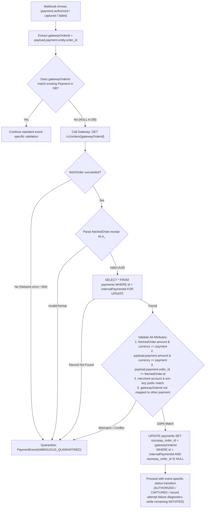
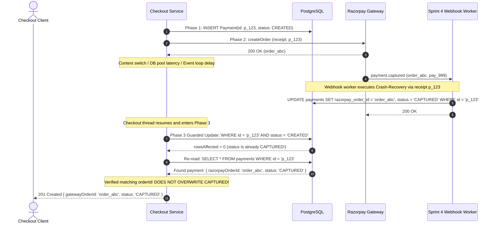

# LA-12 — Phase 2, Sprint 3: Decoupled Checkout & Razorpay Order Creation

## Stage 2 Final Architecture Specification & Approval Gate (Revised)

**Repository:** `La-Vivenzia/lavivenzia-platform`
**Initiative:** `LA-12 — Intermediate Host SaaS Development & Ecosystem Integration`
**Milestone:** Phase 2, Step 3 — Decoupled Checkout & Razorpay Order Creation
**Document Status:** `STAGE 2 FINAL DESIGN REVISED — PENDING USER APPROVAL GATE`
**Target Pilot:** Pune Pilot MVP 2026

---

## 1. Executive Summary & Scope Boundaries

### Objective

Implement the decoupled checkout and Razorpay order-creation pipeline using the existing booking and payment architecture. The endpoint initiates a Razorpay gateway order and associates it with an existing, authenticated, valid `HELD` booking.

This is strictly a **payment-order initiation milestone**, not a payment-confirmation or refund-execution milestone.

### Strict Scope Boundaries

- **In-Scope (Sprint 3):**
  - Canonical order creation endpoint: `POST /api/v1/checkout/orders`.
  - Server-side booking ownership validation (`requirePrincipal()`).
  - Active 5-minute hold TTL validation (`heldUntil > now()`).
  - Authoritative amount calculation in integer minor units (paise) from persisted booking records.
  - Unique attempt-level receipt generation (`p_<internal Payment UUID>`, length $\le 38$ characters).
  - Dual metadata correlation passing `{ paymentId, bookingId }` in gateway `notes`.
  - Two-phase short database transaction boundaries (eliminating remote network lock starvation).
  - Concurrency-safe duplicate request serialization via PostgreSQL row locks and attempt persistence.
  - Coherent order reuse policy: active `INITIATED` orders are reused idempotently for payment retries while hold is valid; failed transaction attempts (`payment.failed`) record attempt metadata while keeping `Payment` in `INITIATED`, never prematurely marking `FAILED`.
  - Separation of internal reconciliation from gateway order closure: point-in-time absence of authorizations never permits duplicate gateway orders while an existing order remains payable.
  - Failure classification distinguishing definitive gateway rejections from ambiguous gateway outcomes.
  - Safe blocking on unresolved outcomes (`CREATED`, `INITIATED_UNCERTAIN`), ensuring the application blocks new order creation while a prior attempt remains unresolved, subject to the persisted concurrency invariant.
  - Guarded Phase 3 conditional updates and re-read protocol resolving fast webhook races before Phase 3 commits without overwriting newer states (`AUTHORIZED`, `CAPTURED`).
  - Operational failure logging as a diagnostic aid with explicit acknowledgement of process log volatility.
  - Non-authoritative frontend modal dismissal contract (DB record remains `INITIATED`).
  - Comprehensive Sprint 4 handoff design covering event-specific webhook validation rules, crash-recovery protocol via `fetchOrder` and receipt parsing, guarded late webhook processing after reconciliation, explicit separation of `AUTHORIZED` vs `CAPTURED`, strict enforcement of the expired-hold invariant, and deadlock-free hierarchical lock ordering (`experience_slots` $\rightarrow$ `bookings` $\rightarrow$ `payments`).
- **Strictly Out-of-Scope (Deferred to Future Milestones):**
  - **Sprint 4 (Webhook Ingestion & Confirmation):** Razorpay webhook ingestion endpoint (`POST /api/v1/webhooks/razorpay`), webhook HMAC SHA256 signature verification, implementation of `fetchOrder` in `RazorpayAdapter`, `PaymentEvent` outbox deduplication pipeline, event-specific schema dispatch, atomic capacity revalidation under lock, booking status transition to `CONFIRMED`, `ExperienceSlot.reservedCount` increment, Ed25519 cryptographic voucher issuance, and `RefundTask` record creation for unfulfilled payments.
  - **Sprint 5 / Dedicated Refund Worker:** Actual gateway refund execution via Razorpay Refund API (`POST /v1/payments/{payment_id}/refund`), gateway void/cancellation calls for uncaptured authorizations, retry loops, and refund reconciliation sweeps.

---

## 2. Gateway Capabilities & Architecture Reality Audit

To eliminate unsupported assumptions, the existing codebase and payment gateway behaviors have been empirically audited and classified:

| Capability / Assumption              | Reality in Codebase & Gateway                                                                                                                                                                                                                                 |                                  Classification                                   | Architectural Impact                                                                                                                                   |
| :----------------------------------- | :------------------------------------------------------------------------------------------------------------------------------------------------------------------------------------------------------------------------------------------------------------ | :-------------------------------------------------------------------------------: | :----------------------------------------------------------------------------------------------------------------------------------------------------- |
| **Order Creation**                   | Implemented in [`src/adapters/payments/razorpay/index.ts`](file:///d:/Desktop/lavivenzia-platform/src/adapters/payments/razorpay/index.ts) (`createOrder`). Uses Basic Auth, 8s abort signal, minor units (paise).                                            |                               `VERIFIED CAPABILITY`                               | Directly reusable for Sprint 3.                                                                                                                        |
| **Receipt Max Length**               | Razorpay caps `receipt` at 40 characters.                                                                                                                                                                                                                     |                           `VERIFIED GATEWAY CONSTRAINT`                           | `p_<internal Payment UUID>` has length $2 + 36 = 38\text{ chars} \le 40$. Slicing at 40 does not truncate.                                             |
| **Receipt Uniqueness**               | Official Razorpay docs designate `receipt` as an optional merchant tracking string and recommend uniqueness. **Runtime enforcement of receipt uniqueness has not been independently verified. The application does not rely on gateway-side uniqueness.**     |           `DOCUMENTED RECOMMENDATION / RUNTIME ENFORCEMENT UNVERIFIED`            | Application must never rely on gateway receipt rejection to prevent duplicate orders. Concurrency locks must be enforced in PostgreSQL.                |
| **Order Fetch by ID**                | Razorpay REST API supports `GET /v1/orders/{order_id}` returning `{ id, amount, currency, receipt, status, notes }`. In our codebase, `fetchOrder(orderId)` is **not implemented** in `PaymentGatewayPort` or `RazorpayAdapter`.                              |          `SUPPORTED BY GATEWAY API / NOT IMPLEMENTED IN CURRENT ADAPTER`          | Gateway capability exists. Sprint 4 must implement `fetchOrder` in `RazorpayAdapter` before the crash recovery protocol is operational.                |
| **Order Search by Receipt**          | Razorpay REST API **does not support** querying or filtering orders by `receipt` (`GET /orders?receipt=...` is unsupported by Razorpay API).                                                                                                                  |                            `NOT SUPPORTED BY GATEWAY`                             | Application cannot out-of-band poll or query Razorpay using `p_<internal Payment UUID>` without knowing `order_id`.                                    |
| **Definitive Gateway Order Closure** | Standard Razorpay Orders API returns statuses `"created"`, `"attempted"`, and `"paid"`. Razorpay standard orders **do not expose a public order cancellation endpoint or guaranteed automatic public TTL** transitioning to a "cancelled" or "expired" state. | `UNSUPPORTED API CAPABILITY / CLOSURE CANNOT BE ESTABLISHED VIA PUBLIC API ALONE` | System cannot establish definitive order closure through automated API polling while an order is open. An open order remains payable on gateway rails. |
| **Bank Authorization Timestamp**     | `payment.entity.created_at` represents transaction creation in Razorpay, **not** the timestamp of issuing bank authorization approval. Gateway payloads do not expose an explicit bank authorization timestamp.                                               |                          `GATEWAY TIMESTAMP LIMITATION`                           | `payment.entity.created_at` is supporting evidence only, not mathematical proof that bank authorization preceded hold expiry.                          |
| **Payment Notes Inheritance**        | Whether `payload.payment.entity.notes` reliably inherits order `notes` across all payment methods without client re-specification.                                                                                                                            |                        `UNVERIFIED / PENDING TEST FIXTURE`                        | Secondary correlation aid only; `payload.order.entity.receipt` and `order_id` remain primary anchors.                                                  |
| **Payment Status Enum**              | PostgreSQL native enum `payment_status` contains: `CREATED`, `INITIATED`, `INITIATED_UNCERTAIN`, `AUTHORIZED`, `CAPTURED`, `FAILED`, `REFUNDED`, `RECONCILED_ABANDONED`.                                                                                      |                                 `VERIFIED SCHEMA`                                 | All required states exist natively in Prisma schema and database. No DDL migrations needed.                                                            |
| **Short DB Locks**                   | PostgreSQL `SELECT ... FOR UPDATE` held across network calls causes connection pool exhaustion (`max: 20`).                                                                                                                                                   |                                 `VERIFIED HAZARD`                                 | Two-phase pattern with decoupled short database transactions is mandatory.                                                                             |

---

## 3. Coherent Payment Retry Policy & Gateway Order Closure Safety

### Separation of Internal Reconciliation from Gateway Order Closure

There is a fundamental architectural distinction between:

1. **Internal Financial Reconciliation (Point-in-Time):** An administrative classification for internal bookkeeping, investigation, or audit marking a payment record as unfulfilled or abandoned.
2. **Verified Inability of a Gateway Order to Accept Future Payment:** An immutable, gateway-level guarantee that the external order can never produce a successful charge.

Because standard Razorpay Orders API exposes no cancellation endpoint (`POST /orders/{id}/cancel` does not exist) and no `"cancelled"` status for standard orders, an existing order **remains payable on Razorpay's infrastructure**. A merchant dashboard inspection showing zero current authorizations is merely a point-in-time observation; it does **not** prove that the customer cannot complete a transaction seconds or minutes later via an open checkout tab or delayed bank authorization.

### Safety Rules Governing Order Creation and Retries:

1. **No New Orders Based on Dashboard Zero-Authorization Checks:** A dashboard check showing zero authorizations must **never**, by itself, permit the creation of a new gateway order.
2. **Idempotent Reuse of Active Orders:** If a customer initiates checkout and an existing `Payment` record is in `INITIATED` status with a valid `razorpayOrderId`, and the booking hold is active (`heldUntil > now()`), the endpoint **returns `200 OK` with the existing `gatewayOrderId` (Scenario B: Idempotent Replay)**.
3. **Transient Failures are Non-Terminal (Transaction Attempt Failures):** An incoming `payment.failed` webhook represents a failed _transaction attempt_ at the customer's issuing bank or payment rail, **not** the failure or closure of the Razorpay gateway order. A failed card decline, UPI timeout, or netbanking error must **never** transition the internal `Payment` to `FAILED` if the gateway order remains payable. The `Payment` record strictly remains in `INITIATED` status, with failed transaction diagnostics recorded. The customer is permitted and expected to re-attempt payment against the same gateway order.
4. **Permanent Association Invariant:** While a booking hold is active, if an order exists with an `order_id`, it is associated with that booking. **No second gateway order can be created for that booking.**
5. **Definitive Rejection Exception:** A new gateway order is permitted if and only if the initial order creation attempt failed definitively before an order ID was ever generated (e.g. gateway HTTP 400 validation rejection or HTTP 401/403 authentication error, where `Payment` is marked `FAILED`), AND the booking hold is active (`heldUntil > now()`).
6. **Preservation of Late Authorizations & Captures:** An earlier transaction attempt that reported `payment.failed` may subsequently transition to authorized or captured on gateway rails (e.g. late issuer authorization or settlement). Retaining the order in `INITIATED` ensures that late `payment.authorized` and `payment.captured` webhooks are ingested and processed seamlessly without being rejected as state regressions.

```mermaid
sequenceDiagram
    autonumber
    actor Client as Client / Browser
    participant API as Checkout Order API
    participant DB as PostgreSQL (lavivenzia)
    participant RZP as Razorpay Gateway
    participant WH as Sprint 4 Webhook Worker

    Note over Client,WH: Initial Checkout: Order Creation
    Client->>API: POST /api/v1/checkout/orders { bookingId }
    API->>DB: Phase 1: Verify hold active; INSERT Payment(status: CREATED)
    API->>RZP: Phase 2: createOrder (receipt: p_<internalPaymentId>)
    RZP-->>API: 200 OK (order_1)
    API->>DB: Phase 3: UPDATE Payment(status: INITIATED, orderId: order_1)
    API-->>Client: 201 Created { gatewayOrderId: "order_1" }

    Note over Client,WH: Transaction Attempt 1 Fails
    Client->>RZP: Customer attempts card payment on order_1
    RZP->>WH: payment.failed (Card declined by issuer)
    Note over WH,DB: Payment record remains INITIATED (Order still open on gateway)

    Note over Client,WH: Customer Retries Payment
    Client->>API: POST /api/v1/checkout/orders { bookingId } (Retry)
    API->>DB: Evaluates hold active; Finds existing INITIATED payment (order_1)
    API-->>Client: 200 OK { gatewayOrderId: "order_1" } (IDEMPOTENT REPLAY)
    Note over Client,API: Same gateway order reused! ZERO duplicate gateway orders!

    Note over Client,WH: Transaction Attempt 2 Succeeds
    Client->>RZP: Customer completes payment on order_1 via UPI
    RZP->>WH: payment.captured (pay_123, order_1)
    WH->>DB: Atomic Fulfilment: Confirms Booking; Payment = CAPTURED
```

---

## 4. Multi-Dimensional State Progression & Guarded Late Transitions

`FAILED` and `RECONCILED_ABANDONED` are internal administrative/outcome states, **not permanently terminal against external gateway financial truth**. If money was debited at the customer's bank, external financial reality supersedes internal administrative assumptions.

### Separated State Dimensions

1. **Initiation & Gateway Transit Dimension:**
   - `CREATED`: Pre-call allocation in PostgreSQL.
   - `INITIATED`: Gateway order created; awaiting customer payment attempts.
   - `INITIATED_UNCERTAIN`: Network timeout or ambiguous gateway response where PostgreSQL was reachable to record uncertainty.
2. **Positive Financial Progression Dimension (Monotonic Forward):**
   - `AUTHORIZED`: Customer bank blocked funds. Distinct from capture. Uncaptured authorizations can be voided without refund rails.
   - `CAPTURED`: Funds settled and collected. Reversing requires a formal `RefundTask`.
   - `REFUNDED`: Verified completion of refund rails at gateway.
3. **Internal Administrative Outcome Dimension:**
   - `FAILED`: Internal administrative outcome state strictly reserved for definitive order-creation rejections where no gateway order was created (e.g. gateway HTTP 400/401/403 validation or credentials rejection). It is **never** applied to a failed customer transaction attempt (card decline, UPI failure), because the underlying gateway order remains open and payable. Manual reconciliation alone must not establish gateway closure, an open order must never be treated as closed based on a dashboard snapshot, and no new gateway order is allowed while a previous order may still accept payment.
   - `RECONCILED_ABANDONED`: Internal administrative state indicating hold expiry or audit closure.

### State-Protection Invariants & Guarded Transitions:

1. **Guarded Late Transitions from Outcome States:** If an internal payment was marked `FAILED` (e.g. order-creation rejection where gateway nevertheless generated an order prior to connection drop) or `RECONCILED_ABANDONED`, but a verified late gateway event arrives, the system enforces guarded transitions:
   - `FAILED` $\longrightarrow$ `AUTHORIZED` (on verified `payment.authorized`)
   - `FAILED` $\longrightarrow$ `CAPTURED` (on verified `payment.captured` or `order.paid`)
   - `RECONCILED_ABANDONED` $\longrightarrow$ `AUTHORIZED` (on verified `payment.authorized`)
   - `RECONCILED_ABANDONED` $\longrightarrow$ `CAPTURED` (on verified `payment.captured` or `order.paid`)
2. **Webhook Processing Never Disabled:** Webhook processing must **never** be disabled or rejected because an internal record is marked `FAILED` or `RECONCILED_ABANDONED`. Incoming gateway events are always validated and processed.
3. **Monotonic Financial Truth:** `CAPTURED` and `AUTHORIZED` can **never** regress to `FAILED`, `INITIATED`, or `CREATED` upon receiving delayed or out-of-order `payment.failed` webhooks.
4. **Transaction Attempt Failures Keep Record `INITIATED`:** Incoming `payment.failed` webhooks record failure diagnostics (`error_code`, `error_description`, `error_reason`) while the `Payment.status` strictly remains `INITIATED`. A failed transaction attempt never transitions the payment to `FAILED` and never permits a duplicate gateway order.
5. **Authorization Distinct from Capture:** An uncaptured duplicate authorization (`AUTHORIZED`) must be **voided/released**, never refunded. Only verified `CAPTURED` payments enqueue a `RefundTask`.
6. **Idempotent Refund Creation:** `refund_tasks` enforces `UNIQUE(payment_id)` in PostgreSQL, preventing duplicate refund entries.
7. **No Time-Based Closure of Unresolved States:** Neither `CREATED` nor `INITIATED_UNCERTAIN` may be transitioned to `FAILED` or `RECONCILED_ABANDONED` based solely on elapsed time.

---

## 5. Webhook Validation & Late Webhook Handling After Reconciliation

### Internal Payment ID vs. Razorpay Payment ID Distinction

- **Receipt Source:** The receipt passed to Razorpay is strictly formatted as `p_<internal Payment UUID>`, where `<internal Payment UUID>` is the primary key of our application's `Payment` record in PostgreSQL.
- **External Gateway Payment ID:** Razorpay's `payload.payment.entity.id` is an external gateway identifier formatted as `pay_[a-zA-Z0-9]+`.
- **Core Rule:** The application **never** compares or constructs receipts using Razorpay's external payment ID. The internal Payment UUID is extracted _from_ the receipt string to look up the database record.

### Event-Specific Validation Rules

#### 1. `order.paid`

- **Payload Structure:** Contains both `payload.order.entity` and `payload.payment.entity`.
- **Correlation & Validation Procedure:**
  1. Read `payload.order.entity.receipt`.
  2. Parse receipt: must match format `^p_([0-9a-fA-F-]{36})$`. Extract `internalPaymentId = receipt.substring(2)`.
  3. Query database: `SELECT * FROM payments WHERE id = :internalPaymentId FOR UPDATE`.
  4. Assert `payload.order.entity.id` matches format `^order_[a-zA-Z0-9]+$`. If `payments.razorpayOrderId` is populated, assert exact match.
  5. Assert `payload.order.entity.amount === payment.amountMinorUnits` AND `payload.order.entity.currency === payment.currency`.
  6. Assert `payload.payment.entity.order_id === payload.order.entity.id`.
  7. Assert `payload.payment.entity.amount === payment.amountMinorUnits` AND `payload.payment.entity.currency === payment.currency`.
  8. Assert `payload.payment.entity.status === "captured"`.
  9. Assert `payload.account_id` matches configured merchant account ID, and configured `RAZORPAY_KEY_ID` prefix (`rzp_test_` vs `rzp_live_`) matches event mode.
  10. Assert gateway order ID is not already mapped to any _other_ payment in DB.

#### 2. `payment.authorized` & `payment.captured` (Payment-Only Events)

- **Payload Structure:** Payment-only payload (`contains: ["payment"]`). **Does NOT require an `order` entity.**
- **Correlation & Validation Procedure:**
  1. Extract `gatewayOrderId = payload.payment.entity.order_id`.
  2. Check database: `SELECT * FROM payments WHERE razorpay_order_id = :gatewayOrderId FOR UPDATE`.
  3. **If matching Payment record exists:**
     - Assert `payload.payment.entity.amount === payment.amountMinorUnits` AND `currency === payment.currency`.
     - Assert `payload.payment.entity.status === "authorized"` (for `payment.authorized`) or `"captured"` (for `payment.captured`).
     - Assert `payload.account_id` matches configured merchant account ID.
  4. **If stored `razorpayOrderId` is NULL (Crash Recovery Scenario):**
     - Execute the **Fetch-and-Correlate Protocol** (detailed below).

#### 3. `payment.failed` (Payment-Only Event)

- **Payload Structure:** Payment-only payload (`contains: ["payment"]`). **Does NOT require an `order` entity.**
- **Correlation & Validation Procedure:**
  1. Extract `gatewayOrderId = payload.payment.entity.order_id`.
  2. Check database: `SELECT * FROM payments WHERE razorpay_order_id = :gatewayOrderId FOR UPDATE`.
  3. If matching Payment record exists:
     - Assert `payload.payment.entity.status === "failed"`. **Must NOT be rejected for not being authorized/captured.**
     - Record failure metadata (`error_code`, `error_description`, `error_source`, `error_reason`).
     - Payment record status strictly remains `INITIATED` (order remains open and payable). A customer transaction failure must **never** transition the internal Payment to `FAILED`.
     - Does NOT regress status if payment is already `AUTHORIZED` or `CAPTURED`.
  4. If stored `razorpayOrderId` is NULL (Crash Recovery Scenario):
     - Execute the **Fetch-and-Correlate Protocol** (detailed below).

---

### Payment-Only Webhook Crash-Recovery Protocol (Sprint 4 Boundary)

When a payment-only event (`payment.authorized`, `payment.captured`, or `payment.failed`) arrives and the internal `Payment.razorpayOrderId` is `NULL` (application crashed after order creation but before Phase 3 DB persistence):



#### Step-by-Step Protocol:

1. Extract `gatewayOrderId` from `payload.payment.entity.order_id`.
2. Invoke `razorpayAdapter.fetchOrder(gatewayOrderId)` via `GET /v1/orders/{order_id}`.
3. Read `fetchedOrder.receipt`.
4. Validate and parse the receipt: assert format `^p_([0-9a-fA-F-]{36})$`. Extract `internalPaymentId = receipt.substring(2)`.
5. Look up the internal application `Payment` record:
   `SELECT * FROM payments WHERE id = :internalPaymentId AND razorpay_order_id IS NULL FOR UPDATE;`
6. Validate fetched order attributes:
   - `fetchedOrder.amount === payment.amountMinorUnits` AND `fetchedOrder.currency === payment.currency`.
   - `payload.account_id` matches configured merchant account ID.
   - Configured key prefix (`rzp_test_` vs `rzp_live_`) matches order mode.
   - `fetchedOrder.id` is not already mapped to any other payment in DB.
7. Validate payment entity attributes:
   - `payload.payment.entity.id` matches format `^pay_[a-zA-Z0-9]+$`.
   - `payload.payment.entity.order_id === fetchedOrder.id`.
   - `payload.payment.entity.amount === payment.amountMinorUnits` AND `currency === payment.currency`.
   - Status matches event type (`"authorized"` for `payment.authorized`, `"captured"` for `payment.captured`, `"failed"` for `payment.failed`).
8. **Association:** Only after all checks strictly pass, execute:
   `UPDATE payments SET razorpay_order_id = :gatewayOrderId WHERE id = :internalPaymentId AND razorpay_order_id IS NULL;`
9. **Event Action:**
   - If `payment.authorized`: update `status = 'AUTHORIZED'`.
   - If `payment.captured`: update `status = 'CAPTURED'`.
   - If `payment.failed`: update failed transaction attempt metadata; payment status strictly remains `INITIATED`. A failed transaction attempt does **not** close the gateway order, does **not** mark the payment `FAILED`, and does **not** permit a duplicate order.
10. **Quarantine:** If `fetchOrder` fails, receipt is missing/malformed, or any attribute conflicts, immediately quarantine the event in `PaymentEvent(AMBIGUOUS_QUARANTINED)`. Never guess.

> [!IMPORTANT]
> **Gateway API Capability vs. Adapter Implementation:**
> `GET /v1/orders/{order_id}` is supported by the Razorpay REST API, but `fetchOrder` is **not implemented in the current `RazorpayAdapter`**. Sprint 4 must implement `fetchOrder(orderId)` in `RazorpayAdapter` before this crash recovery protocol becomes operational.

---

### Handling Late Webhooks Arriving After Internal Reconciliation

If a gateway event arrives for a payment record that was previously marked `FAILED` or `RECONCILED_ABANDONED` by an operator or cleanup script:

1. **Capture Event (`payment.captured` or `order.paid`):**
   - **Financial Truth Prevails:** The internal record is updated to `status = 'CAPTURED'`. Real money was debited; the database must reflect this fact.
   - **Audit Trail Preserved:** The original administrative reconciliation record is preserved in `payments.reconciliation_history` (e.g. `priorStatus: 'RECONCILED_ABANDONED', note: 'Reopened by verified late gateway capture'`).
   - **Inventory Protection (Expired-Hold Invariant):** Under row lock, evaluate booking hold:
     - If the booking hold has expired (`booking.heldUntil <= now()`) or inventory was reallocated: **NEVER confirm the booking! NEVER increment `slot.reservedCount`!**
     - Record `unfulfilledReason = 'HOLD_EXPIRED'`.
     - Enqueue a `RefundTask(status: 'PENDING')` (or reuse existing) to return the customer's funds via automated refund rails.
2. **Authorization Event (`payment.authorized`):**
   - The internal record is updated to `status = 'AUTHORIZED'`.
   - Record `unfulfilledReason = 'LATE_AUTHORIZATION_POST_RECONCILIATION'`.
   - Follow the approved **void/release workflow** for uncaptured authorizations. Do **not** capture; do **not** create a `RefundTask`.

---

## 6. Timestamp Limitations & The Expired-Hold Invariant

### Timestamp Limitations

In Razorpay webhook payloads, `payload.payment.entity.created_at` ($T_{\text{init}}$) records when the payment attempt was created on Razorpay servers. **The exact bank authorization approval timestamp is unavailable.** Therefore, $T_{\text{init}} \le \text{heldUntil}$ is supporting evidence only, not mathematical proof that bank authorization preceded hold expiry.

### The Expired-Hold Invariant

> [!IMPORTANT]
> **Core Architectural Invariant:** A booking whose hold has passed (`booking.heldUntil <= now()`) **must NOT be confirmed simply because capacity remains available in the slot**.
>
> - The database row status `HELD` is **not** proof that a hold is active; the timestamp `heldUntil` must be strictly validated under lock (`heldUntil > now()`).
> - An expired hold releases the reservation rights.
> - Preserving captured payments: if a capture arrives for an expired hold, record `status = 'CAPTURED'`, `unfulfilledReason = 'HOLD_EXPIRED'`.
> - **Do NOT confirm the expired booking.**
> - **Do NOT increment `slot.reservedCount`.**
> - Enqueue a `RefundTask(status: 'PENDING')` for verified captured payments.
> - No exceptions permitted without an approved business-policy decision.

---

## 7. Atomic Inventory Fulfilment & Hierarchical Lock Ordering

### Deadlock Prevention: Consistent Hierarchical Lock Ordering

All reservation and fulfilment transactions acquire row-level locks in the exact same hierarchical order:

$$\text{Lock Order: } \text{1. } \mathbf{experience\_slots} \quad \longrightarrow \quad \text{2. } \mathbf{bookings} \quad \longrightarrow \quad \text{3. } \mathbf{payments}$$

### Live Available Capacity Calculation

Live capacity calculation accounts for confirmed reservations AND active concurrent holds:

$$\text{ActiveHolds} = \sum_{\substack{b \in \text{Bookings}(\text{slotId}) \\ b.\text{status} = \text{'HELD'} \\ b.\text{heldUntil} > \text{now()} \\ b.\text{id} \neq \text{currentBookingId}}} b.\text{guestCount}$$

$$\text{AvailableCapacity} = \text{slot.capacityTotal} - \text{slot.reservedCount} - \text{ActiveHolds}$$

### Atomic Fulfilment Transaction Pattern

```sql
-- [ATOMIC FULFILMENT TRANSACTION]
BEGIN;

-- 1. Acquire Locks in Strict Hierarchical Order
SELECT * FROM experience_slots WHERE id = :slotId FOR UPDATE;
SELECT * FROM bookings WHERE id = :bookingId FOR UPDATE;
SELECT * FROM payments WHERE id = :paymentId FOR UPDATE;

-- 2. Verify Current Hold Validity (Expired-Hold Invariant)
-- Assert booking.status == 'HELD'
-- Assert booking.heldUntil > now()  <-- MUST BE CURRENTLY VALID!

-- 3. Calculate Live Capacity Under Slot Lock
-- ActiveHolds = sum of active HELD guestCount for other bookings
-- AvailableCapacity = slot.capacityTotal - slot.reservedCount - ActiveHolds

-- 4. Mutually Exclusive Branch Execution (Application evaluates condition and executes Branch A OR Branch B):
-- IF (booking.status == 'HELD' AND booking.heldUntil > now() AND booking.guestCount <= AvailableCapacity) THEN

    -- BRANCH A: ELIGIBLE FULFILMENT
    UPDATE bookings SET status = 'CONFIRMED' WHERE id = :bookingId;
    UPDATE experience_slots SET reserved_count = reserved_count + :guestCount WHERE id = :slotId;
    UPDATE payments SET status = 'CAPTURED', razorpay_order_id = :orderId WHERE id = :paymentId;
    -- Generate Master Trip Voucher

-- ELSE

    -- BRANCH B: INELIGIBLE (Hold Expired [heldUntil <= now()] / Inventory Reallocated / Already Confirmed)
    -- DO NOT CONFIRM BOOKING
    -- DO NOT INCREMENT slot.reserved_count
    UPDATE payments SET status = 'CAPTURED',
                        razorpay_order_id = :orderId,
                        unfulfilled_reason = :reason ('HOLD_EXPIRED' | 'INVENTORY_UNAVAILABLE' | 'DUPLICATE_PAYMENT_LATE_AUTHORIZATION')
    WHERE id = :paymentId;
    INSERT INTO refund_tasks (id, payment_id, amount_minor_units, reason, status)
    VALUES (:uuid, :paymentId, :amount, :reason, 'PENDING')
    ON CONFLICT (payment_id) DO NOTHING;

-- END IF;

-- 5. Final Single Commit (Closes the entire transaction atomically)
COMMIT;
```

---

## 8. Crash-Recovery & Distinguishing Database Failure Outcomes

### The Limits of Process Logging

Writing structured log entries to `process.stderr` is an **operational recovery aid**, NOT a transactional persistence guarantee. In power failures or kernel panics, unbuffered log lines can be lost. The system **never claims guaranteed reconciliation based solely on a process log write.**

### Distinguishing Database Failure Outcomes

1. **Gateway Timeout with Database Available:** The application catches the timeout/network abort, executes Phase 3, and persists `INITIATED_UNCERTAIN`.
2. **Database Unavailable After Gateway Success:** If PostgreSQL crashes or suffers a network partition after Razorpay returns HTTP 200:
   - The application **cannot guarantee a status update** to `INITIATED_UNCERTAIN` because PostgreSQL is unreachable.
   - The database row **remains in `CREATED` status**.
   - Emits structured stderr operational log as a diagnostic aid.
   - **Passive Safety:** When the database recovers, any subsequent checkout call detects `status == 'CREATED'` and is safely blocked (`409 Conflict`, `ORDER_STATUS_UNRESOLVED`). New gateway order creation is strictly blocked without relying on process logs.
   - When the customer pays, the Sprint 4 webhook resolves the record via `p_<internalPaymentId>` using the crash recovery protocol.

---

## 9. Gateway Error & Failure Classification

| Failure Category                     | Physical Condition / Gateway Response                                                                                          |                          Gateway Order Created?                          | System Action & Payment Status                                                                                  |                      Can Client Re-Attempt with New Order?                      |
| :----------------------------------- | :----------------------------------------------------------------------------------------------------------------------------- | :----------------------------------------------------------------------: | :-------------------------------------------------------------------------------------------------------------- | :-----------------------------------------------------------------------------: |
| **Definitive Validation Error**      | HTTP `400 Bad Request` with structured error body (e.g. `BAD_REQUEST_ERROR: Amount exceeds limits`, `currency not supported`). |                           **Definitively NO**                            | `Payment` updated to `FAILED` with `errorCode = 'BAD_REQUEST'`.                                                 |          **YES**, if booking hold still active (`heldUntil > now()`).           |
| **Definitive Auth / Config Error**   | HTTP `401 Unauthorized` / `403 Forbidden` (invalid Razorpay key ID or secret).                                                 |                           **Definitively NO**                            | `Payment` updated to `FAILED` with `errorCode = 'GATEWAY_AUTH_ERROR'`.                                          |               **YES**, once credentials fixed and if hold active.               |
| **Definitive Endpoint Error**        | HTTP `404 Not Found` (invalid URL).                                                                                            |                           **Definitively NO**                            | `Payment` updated to `FAILED` with `errorCode = 'GATEWAY_ENDPOINT_ERROR'`.                                      |                       **YES**, once configuration fixed.                        |
| **Ambiguous Server Error**           | HTTP `500 Internal Server Error`, `502 Bad Gateway`, `503 Service Unavailable`, `504 Gateway Timeout` from Razorpay edge.      | **AMBIGUOUS** (Gateway DB may have committed before edge proxy errored). | `Payment` updated to `INITIATED_UNCERTAIN` (if DB available) with `errorCode = 'GATEWAY_ERROR_AMBIGUOUS'`.      |             **NO. BLOCKED.** Re-attempt forbidden until reconciled.             |
| **Network Timeout**                  | Socket timeout $> 8,000\text{ms}$ or `AbortController` signal triggered.                                                       |   **AMBIGUOUS** (Packet reached gateway; response delayed in transit).   | `Payment` updated to `INITIATED_UNCERTAIN` (if DB available) with `errorCode = 'GATEWAY_TIMEOUT'`.              |             **NO. BLOCKED.** Re-attempt forbidden until reconciled.             |
| **Connection Reset**                 | `ECONNRESET`, `ETIMEDOUT`, `EPIPE`, TLS handshake termination.                                                                 | **AMBIGUOUS** (TCP connection reset may have occurred during response).  | `Payment` updated to `INITIATED_UNCERTAIN` (if DB available) with `errorCode = 'CONNECTION_RESET'`.             |             **NO. BLOCKED.** Re-attempt forbidden until reconciled.             |
| **Application Crash**                | Node.js process killed before Phase 3 DB update commits.                                                                       |            **AMBIGUOUS** (Gateway succeeded, DB unnotified).             | `Payment` remains in `CREATED` state in DB with `razorpayOrderId = NULL`.                                       |           **NO. BLOCKED.** Detected by query; returns `409 Conflict`.           |
| **DB Failure After Gateway Success** | PostgreSQL unavailable when committing Phase 3 after HTTP 200.                                                                 |                       **YES (`order_xyz` exists)**                       | Emits stderr operational log; DB record remains `CREATED` (status update not guaranteed).                       |        **NO. BLOCKED.** Subsequent requests blocked by `CREATED` status.        |
| **Customer Attempt Failure**         | Webhook `payment.failed` received (issuer card decline, insufficient funds, UPI timeout).                                      |                    **YES (`order_xyz` remains open)**                    | `Payment` status strictly remains `INITIATED`; records attempt diagnostics (`error_code`, `error_description`). | **NO (Order Reused).** Customer retries on existing order. Fresh order blocked. |

---

## 10. Frontend Modal Dismissal Contract

> [!CAUTION]
> **Prohibited Transition:** Transitioning `INITIATED -> FAILED` when a customer closes or dismisses the Razorpay Checkout modal is **STRICTLY PROHIBITED**.

### Specification for Modal Dismissal Handling

1. **Frontend Behavior:** When the customer dismisses the Razorpay modal (`modal.ondismiss`), the frontend client merely resets its UI loading spinner and displays the booking summary with an active "Resume Payment" button.
2. **Zero Persisted Financial State Mutation:** The frontend does **not** call an API endpoint to fail the payment. The persisted `Payment` record remains in `INITIATED` status.
3. **Idempotent Re-engagement:** If the customer clicks "Resume Payment" or "Pay Now" again before the hold expires:
   - Frontend calls `POST /api/v1/checkout/orders` with `{ bookingId }`.
   - Backend detects existing `Payment` in `INITIATED` status with valid `razorpay_order_id`.
   - Backend immediately responds with `200 OK` (Scenario B: Idempotent Replay) returning the existing `gatewayOrderId`.
   - Frontend reopens the Razorpay checkout modal with the exact same order.
   - **Outcome:** Zero database mutations, zero new gateway orders, and seamless customer UX.

---

## 11. Sprint Boundary & Milestone Ownership for Refunds

```
┌────────────────────────────────────────────────────────────────────────────────────────┐
│                   PAYMENT SETTLEMENT & REFUND MILESTONE TAXONOMY                       │
└────────────────────────────────────────────────────────────────────────────────────────┘

  [Stage 1: Gateway Capture Verification & Record Preservation] ── MILESTONE: SPRINT 4
    ├── Ingest verified webhook event (HMAC signature validated)
    ├── Match Payment record via exact Primary Key lookup: payments.id = extracted_internal_payment_id
    ├── Assert: payload.payment.amount == payment.amountMinorUnits
    ├── Assert: payload.payment.currency == payment.currency
    └── If status is captured: UPDATE payments SET status = 'CAPTURED', razorpay_order_id = :orderId
    └── If status is authorized only: UPDATE payments SET status = 'AUTHORIZED' (DO NOT CAPTURE)

  [Stage 2: Fulfilment Eligibility Determination] ─────────────── MILESTONE: SPRINT 4
    ├── Acquire hierarchical locks: experience_slots -> bookings -> payments
    ├── Check: booking.status == 'HELD'
    ├── Check: booking.heldUntil > now()  <-- EXPIRED-HOLD INVARIANT
    ├── Recompute: AvailableCapacity = capacityTotal - reservedCount - ActiveHolds
    ├── Check: booking.guestCount <= AvailableCapacity
    ├── If ELIGIBLE:
    │     ├── UPDATE bookings SET status = 'CONFIRMED'
    │     ├── Increment slot reservedCount = reservedCount + guestCount
    │     └── Issue cryptographically signed voucher
    └── If INELIGIBLE (Hold Expired [heldUntil <= now()] / Inventory Reallocated):
          ├── DO NOT CONFIRM BOOKING
          ├── Record payment: unfulfilledReason = 'HOLD_EXPIRED' | 'INVENTORY_UNAVAILABLE'
          └── Proceed to Stage 3 (Enqueue Refund if captured; queue void if authorized only)

  [Stage 3: RefundTask Record Creation (Enqueueing)] ───────────── MILESTONE: SPRINT 4
    ├── If payment.status == 'CAPTURED':
    │     ├── INSERT INTO refund_tasks (id, payment_id, amount_minor_units, status: 'PENDING')
    │     │     ON CONFLICT (payment_id) DO NOTHING
    │     └── COMMIT database transaction (Refund is ENQUEUED, NOT YET EXECUTED)
    └── If payment.status == 'AUTHORIZED':
          └── Queue void/cancellation action (NOT a refund)

  [Stage 4: Gateway Refund Execution & Settlement] ────────────── MILESTONE: SPRINT 5 / REFUND WORKER
    ├── Asynchronous worker pulls PENDING RefundTask rows
    ├── Invoke Razorpay Refund API: POST /v1/payments/{payment_id}/refund
    ├── Await gateway response; assert refund ID generated
    ├── UPDATE payments SET status = 'REFUNDED'
    └── UPDATE refund_tasks SET status = 'COMPLETED', provider_refund_id = :refundId
```

---

## 12. Complete Payment Lifecycle State-Transition Matrix

The lifecycle transitions conform strictly to the native Prisma `PaymentStatus` enum:

| Initial State              | Target State               | Triggering Evidence                                                                                                      |              Gateway Call Allowed?              |        Order Reusable?        |          Mandatory Reconciliation?          | System Owner                            |
| :------------------------- | :------------------------- | :----------------------------------------------------------------------------------------------------------------------- | :---------------------------------------------: | :---------------------------: | :-----------------------------------------: | :-------------------------------------- |
| _(None)_                   | **`CREATED`**              | Phase 1 DB insert before remote network dispatch.                                                                        |      **Yes** (the single in-flight call).       |              No               |            No (Active attempt).             | `CheckoutOrdersService` (Phase 1)       |
| **`CREATED`**              | **`INITIATED`**            | Razorpay returns HTTP 200 with valid `order.id` (Phase 3 DB update commits).                                             |             **No** (Order exists).              | **Yes** (HTTP 200 OK replay). |                     No                      | `CheckoutOrdersService` (Phase 3)       |
| **`CREATED`**              | **`FAILED`**               | Gateway returns definitive order-creation rejection (HTTP 400/401/403) before order ID created.                          | **Yes** (New attempt permitted if hold active). |              No               |                     No                      | `CheckoutOrdersService` (Phase 3)       |
| **`CREATED`**              | **`INITIATED_UNCERTAIN`**  | Timeout (>8000ms), connection reset, HTTP 500/502/503/504 **with database available**.                                   |                **No. BLOCKED.**                 |    No (Returns 504 / 409).    |  **Yes** (Logged for webhook correlation).  | `CheckoutOrdersService` (Phase 3 Catch) |
| **`CREATED`**              | **`CAPTURED`**             | Sprint 4 webhook arrives with verified correlation (`p_<internalPaymentId>`) after app crash.                            |                     **No**                      |              No               |           Yes (Self-reconciling).           | `RazorpayWebhookWorker` (Sprint 4)      |
| **`CREATED`**              | **`RECONCILED_ABANDONED`** | Hold expired (`heldUntil <= now()`) and marked abandoned by cleanup sweeper.                                             |                     **No**                      |              No               |            Yes (Audit recorded).            | `PaymentReconciliationWorker`           |
| **`INITIATED`**            | **`INITIATED`**            | Verified `payment.failed` webhook (failed customer card/UPI attempt). Gateway order remains payable.                     |                     **No**                      |            **Yes**            |    No (Attempt failure metadata logged).    | `RazorpayWebhookWorker` (Sprint 4)      |
| **`INITIATED`**            | **`AUTHORIZED`**           | Verified `payment.authorized` webhook received.                                                                          |                     **No**                      |              No               |                     No                      | `RazorpayWebhookWorker` (Sprint 4)      |
| **`INITIATED`**            | **`CAPTURED`**             | Verified `payment.captured` or `order.paid` webhook received.                                                            |                     **No**                      |              No               |                     No                      | `RazorpayWebhookWorker` (Sprint 4)      |
| **`INITIATED`**            | **`RECONCILED_ABANDONED`** | Booking hold expired (`heldUntil <= now()`) and marked abandoned by cleanup sweeper. (Order remains payable on gateway). |                     **No**                      |              No               |            Yes (Audit recorded).            | `PaymentReconciliationWorker`           |
| **`INITIATED_UNCERTAIN`**  | **`INITIATED`**            | Operator manual reconciliation discovers valid `order_id` at Razorpay.                                                   |                     **No**                      |            **Yes**            |                     Yes                     | Operator / Reconciliation Tool          |
| **`INITIATED_UNCERTAIN`**  | **`CAPTURED`**             | Sprint 4 webhook arrives with verified correlation (`p_<internalPaymentId>`).                                            |                     **No**                      |              No               |                     Yes                     | `RazorpayWebhookWorker` (Sprint 4)      |
| **`INITIATED_UNCERTAIN`**  | **`RECONCILED_ABANDONED`** | Booking hold expired (`heldUntil <= now()`) and marked abandoned by cleanup sweeper.                                     |                     **No**                      |              No               |            Yes (Audit recorded).            | `PaymentReconciliationWorker`           |
| **`FAILED`**               | **`AUTHORIZED`**           | Verified late `payment.authorized` webhook arrives post-reconciliation (guarded transition).                             |                     **No**                      |              No               | Yes (Audit history preserved; void queued). | `RazorpayWebhookWorker` (Sprint 4)      |
| **`FAILED`**               | **`CAPTURED`**             | Verified late `payment.captured` or `order.paid` arrives post-reconciliation (guarded transition).                       |                     **No**                      |              No               | Yes (Audit preserved; RefundTask created).  | `RazorpayWebhookWorker` (Sprint 4)      |
| **`RECONCILED_ABANDONED`** | **`AUTHORIZED`**           | Verified late `payment.authorized` webhook arrives post-reconciliation (guarded transition).                             |                     **No**                      |              No               | Yes (Audit history preserved; void queued). | `RazorpayWebhookWorker` (Sprint 4)      |
| **`RECONCILED_ABANDONED`** | **`CAPTURED`**             | Verified late `payment.captured` or `order.paid` arrives post-reconciliation (guarded transition).                       |                     **No**                      |              No               | Yes (Audit preserved; RefundTask created).  | `RazorpayWebhookWorker` (Sprint 4)      |

> [!CAUTION]
> **Prohibited Transitions & Actions:**
>
> 1. Creating a new gateway order while an existing order has been created (`INITIATED`) and hold is active is **STRICTLY PROHIBITED**.
> 2. Transitioning an open order to `FAILED` or `RECONCILED_ABANDONED` based on a dashboard zero-authorization check to permit a new order is **STRICTLY PROHIBITED**.
> 3. Claiming a state transition from `CREATED` to `INITIATED_UNCERTAIN` when PostgreSQL is unavailable is **STRICTLY PROHIBITED** (the row remains `CREATED`).
> 4. Transitioning `INITIATED -> FAILED` upon frontend modal dismissal or incoming `payment.failed` webhook is **STRICTLY PROHIBITED**. A customer card/UPI decline is an attempt-level event; the underlying gateway order remains open and payable.
> 5. Regressing `CAPTURED` or `AUTHORIZED` to `FAILED` due to out-of-order `payment.failed` webhooks is **STRICTLY PROHIBITED**.
> 6. Disabling webhook processing for payments in `FAILED` or `RECONCILED_ABANDONED` status is **STRICTLY PROHIBITED**.
> 7. Transitioning an open, payable order to `FAILED` or treating an open order as closed based on manual reconciliation or a merchant dashboard snapshot is **STRICTLY PROHIBITED**. An open order remains payable on gateway rails; no new gateway order is allowed while a previous order may still accept payment.

---

## 13. Multi-Instance Concurrency & Two-Phase Transaction Boundaries

### Architectural Anti-Pattern (Strictly Prohibited)

Holding a PostgreSQL row lock (`SELECT ... FOR UPDATE`) or open database transaction across the remote Razorpay network call is **forbidden**.
_Reason:_ Razorpay network calls can take up to $8,000\text{ms}$. Holding a database row lock for 8 seconds exhausts the connection pool (configured at `max: 20`), blocks slot capacity checks, and introduces severe database latency spikes.

### The Two-Phase Short-Transaction Pattern (`PROPOSED DESIGN`)

The architecture is designed to serialize requests and prevent duplicate gateway order creation, subject to PostgreSQL row-level locks (`SELECT ... FOR UPDATE`) and transaction isolation:

```
┌────────────────────────────────────────────────────────────────────────────────────────┐
│                        TWO-PHASE CHECKOUT ORDER LIFECYCLE                              │
└────────────────────────────────────────────────────────────────────────────────────────┘

  [Phase 1: Database Pre-Lock & In-Flight Gate] ── Duration: < 10ms
    ├── BEGIN PostgreSQL Transaction
    ├── SELECT * FROM bookings WHERE id = :bookingId FOR UPDATE
    ├── Assert: booking.userId == authenticatedPrincipal.id (Throws NotFoundError / 404 to prevent ID enumeration)
    ├── Assert: booking.status == 'HELD'
    ├── Assert: booking.heldUntil > now()
    ├── Check existing payments for booking:
    │     ├── If status == 'INITIATED' (with orderId) ──► COMMIT & RETURN EXISTING ORDER (200 OK)
    │     ├── If status == 'CREATED'                  ──► ROLLBACK & THROW 409 (ORDER_CREATION_IN_PROGRESS)
    │     ├── If status == 'INITIATED_UNCERTAIN'      ──► ROLLBACK & THROW 409 (ORDER_STATUS_UNRESOLVED)
    │     └── If status == 'FAILED' (pre-order 4xx)   ──► Proceed with new attempt
    ├── INSERT INTO payments (id, booking_id, amount_minor_units, currency, status)
    │     VALUES (:paymentId, :bookingId, :totalAmount, 'INR', 'CREATED')
    └── COMMIT PostgreSQL Transaction (ALL ROW LOCKS AND CONNECTIONS RELEASED)

  [Phase 2: Remote Gateway Execution] ────────────── Duration: 200ms - 8,000ms
    ├── Zero PostgreSQL locks or connections held
    ├── Call: razorpayAdapter.createOrder({
    │           amount,
    │           referenceId: 'p_' + paymentId,
    │           notes: { paymentId, bookingId }
    │         })
    └── Outcome: Success (200), Definitive Error (4xx), Ambiguous (5xx), or Timeout (>8s)

  [Phase 3: Guarded Database Post-Update & Race Recovery] ──── Duration: < 10ms
    ├── BEGIN PostgreSQL Transaction
    ├── If Gateway Success:
    │     ├── Guarded Update:
    │     │     UPDATE payments SET razorpay_order_id = :orderId, status = 'INITIATED'
    │     │     WHERE id = :paymentId AND status = 'CREATED'
    │     ├── If rowsAffected === 1:
    │     │     └── Normal Success ──► COMMIT & RETURN 201 Created (Scenario A)
    │     └── If rowsAffected === 0 (Race with Webhook Worker):
    │           ├── Re-read: SELECT * FROM payments WHERE id = :paymentId
    │           ├── Case A: reRead.razorpayOrderId === orderId AND status IN ('AUTHORIZED', 'CAPTURED'):
    │           │     └── Webhook beat Phase 3! DO NOT OVERWRITE! ──► COMMIT & RETURN 201 Created (Scenario A2)
    │           ├── Case B: reRead.razorpayOrderId !== null AND !== orderId:
    │           │     └── Conflicting order! ──► ROLLBACK, LOG CRITICAL & RETURN 409 Conflict
    │           └── Case C: status IN ('FAILED', 'RECONCILED_ABANDONED'):
    │                 └── Correlate orderId & RETURN 409 Conflict (ORDER_STATUS_UNRESOLVED)
    ├── If Gateway Definitive Failure:
    │     └── UPDATE payments SET status = 'FAILED', error_code = :code
    │           WHERE id = :paymentId AND status = 'CREATED'
    ├── If Gateway Timeout / Network Abort / 5xx / Exception (DB available):
    │     └── UPDATE payments SET status = 'INITIATED_UNCERTAIN', error_code = :code
    │           WHERE id = :paymentId AND status = 'CREATED'
    └── COMMIT PostgreSQL Transaction
```

### Concurrency Race: Webhook Arrives Before Phase 3 Database Update

A critical race condition can occur when an upstream gateway event arrives before the checkout API thread can commit Phase 3:



#### Detailed Phase 3 Resolution Protocol:

1. **Guarded Conditional Write:**
   All Phase 3 writes must use an exact state guard:
   ```sql
   UPDATE payments
   SET razorpay_order_id = :orderId, status = 'INITIATED'
   WHERE id = :paymentId AND status = 'CREATED';
   ```
2. **Evaluation of `rowsAffected`:**
   - **`rowsAffected === 1`:** Normal path. Phase 3 successfully transitions `CREATED -> INITIATED`. Service returns `201 Created` with `status: "INITIATED"`.
   - **`rowsAffected === 0`:** The payment record status was mutated before Phase 3 could execute. The service **must NOT fail with a generic error** and **must NOT create another gateway order**.
3. **Authoritative Database Re-Read:**
   The service queries the latest state from PostgreSQL:
   ```sql
   SELECT * FROM payments WHERE id = :paymentId;
   ```
4. **Branching Logic on Re-Read State:**
   - **Matching Order & Advanced State (`reRead.razorpayOrderId === orderId` AND `reRead.status IN ('AUTHORIZED', 'CAPTURED', 'REFUNDED')`):**
     - The webhook ingestion pipeline processed a payment event for this exact gateway order before Phase 3 committed.
     - **Non-Clobbering Invariant:** The checkout service **must never overwrite** an `AUTHORIZED`, `CAPTURED`, or `REFUNDED` state with `INITIATED` or `CREATED`.
     - The checkout service accepts the persisted state and returns `201 Created` (Scenario A2) reflecting `{ bookingId, paymentId, gatewayOrderId: orderId, status: reRead.status }`.
     - Client checkout UI proceeds seamlessly without error.
     - **Fulfilment Safety Invariant:** Payment capture is **never** treated as automatic booking confirmation. Downstream fulfilment continues strictly under the atomic fulfilment transaction (Section 7):
       - **Eligible Booking:** If hold is active (`heldUntil > now()`) and capacity is available, booking confirms, `reservedCount` increments exactly once, and voucher issuance proceeds.
       - **Ineligible Booking:** If hold expired (`heldUntil <= now()`) or inventory is unavailable, booking is **NOT** confirmed, `reservedCount` is **NOT** incremented, exactly one `RefundTask` is created, and audit history is preserved.
   - **Conflicting Order ID (`reRead.razorpayOrderId !== null` AND `reRead.razorpayOrderId !== orderId`):**
     - Another process associated an unexpected order ID with this payment.
     - Emit structured `CRITICAL` operational log, quarantine the anomaly, and return `409 Conflict` (`ORDER_STATUS_UNRESOLVED`). Do **NOT** overwrite the database record.
   - **Reconciled / Terminal Administrative State (`reRead.status IN ('FAILED', 'RECONCILED_ABANDONED')`):**
     - If `reRead.razorpayOrderId IS NULL`: Correlate the known `orderId` into `razorpay_order_id` (so late webhooks can resolve the payment) while leaving status untouched, and return `409 Conflict` (`ORDER_STATUS_UNRESOLVED`).
   - **Missing Record:**
     - Emit critical log, return `500 Internal Server Error`.

````

---

## 14. Canonical API Contract & Response Semantics

### Canonical Route: `POST /api/v1/checkout/orders`

Headers required:

- `Content-Type: application/json`
- `Cookie: lv_session=<session_token>`
- `Origin: <app_url>` (CSRF validation)

### Request Schema

```json
{
  "bookingId": "8b9487c6-2c93-4e42-998e-4a64860b21a8"
}
````

### Response Matrix across Seven Canonical Scenarios

#### Scenario A: Gateway Order Created Successfully (Happy Path)

- **HTTP Status:** `201 Created`
- **Response Body:**
  ```json
  {
    "bookingId": "8b9487c6-2c93-4e42-998e-4a64860b21a8",
    "paymentId": "7a32e18b-2c93-4e42-998e-4a64860b21a8",
    "gatewayOrderId": "order_MNOP1234567890",
    "orderId": "order_MNOP1234567890",
    "amount": 50000,
    "currency": "INR",
    "receipt": "p_7a32e18b-2c93-4e42-998e-4a64860b21a8",
    "status": "INITIATED"
  }
  ```
  _Note on Contract Alignment:_ `orderId` is provided as an exact alias for `gatewayOrderId` to maintain strict compatibility with frontend consumers (such as `openRazorpayCheckout` in `src/lib/razorpay-checkout.ts` and hosted modal options) without breaking platform-level gateway naming conventions.

#### Scenario A2: Fast Webhook Precedes Phase 3 Database Update (Race Resolution)

- **Condition:** Gateway creates order successfully; webhook worker receives and processes payment event (e.g. `order.paid` or `payment.captured`) advancing `Payment` to `CAPTURED` (or `AUTHORIZED`) before Phase 3 commits; Phase 3 guarded update affects zero rows; service re-reads PostgreSQL, verifies matching `gatewayOrderId`, and returns authoritative persisted state without overwriting or generating duplicate orders.
- **HTTP Status:** `201 Created`
  _Resolution of 201 vs 200:_ `201 Created` is the definitive status code. The checkout order and payment attempt were newly created by this request cycle. The fast webhook processed payment immediately before Phase 3 local commit, but from the client's perspective, order creation succeeded. `200 OK` is strictly reserved for Scenario B (Idempotent Replay of pre-existing orders from earlier requests).
- **Response Body:**
  ```json
  {
    "bookingId": "8b9487c6-2c93-4e42-998e-4a64860b21a8",
    "paymentId": "7a32e18b-2c93-4e42-998e-4a64860b21a8",
    "gatewayOrderId": "order_MNOP1234567890",
    "orderId": "order_MNOP1234567890",
    "amount": 50000,
    "currency": "INR",
    "receipt": "p_7a32e18b-2c93-4e42-998e-4a64860b21a8",
    "status": "CAPTURED"
  }
  ```

#### Scenario B: Existing Gateway Order Already Associated (Idempotent Replay / Modal Re-open)

- **HTTP Status:** `200 OK`
- **Response Body:** Returns the exact same payload as Scenario A with `status: "INITIATED"`. Zero duplicate gateway calls.

#### Scenario C: Gateway Definitively Rejects Request (e.g. HTTP 400 Bad Request)

- **HTTP Status:** `502 Bad Gateway`
- **Response Body:**
  ```json
  {
    "error": {
      "code": "PAYMENT_GATEWAY_ERROR",
      "message": "Payment provider rejected order creation. Please try again.",
      "correlationId": "corr_9a8b7c6d"
    }
  }
  ```

#### Scenario D: Gateway Outcome Uncertain (Timeout > 8000ms / AbortError / 5xx)

- **HTTP Status:** `504 Gateway Timeout`
- **Evaluation of 504 vs 202:** RFC 9110 specifies `504 Gateway Timeout` when an upstream provider fails to respond in time. To prevent client retries from initiating duplicate orders, the response provides explicit structured status:
- **Response Body:**
  ```json
  {
    "error": {
      "code": "PAYMENT_GATEWAY_TIMEOUT",
      "message": "Payment provider timed out. Order outcome is uncertain. Verification in progress.",
      "correlationId": "corr_1234abcd",
      "paymentId": "7a32e18b-2c93-4e42-998e-4a64860b21a8",
      "status": "INITIATED_UNCERTAIN"
    }
  }
  ```

#### Scenario E: Concurrent Request Currently In-Flight

- **HTTP Status:** `409 Conflict`
- **Response Body:**
  ```json
  {
    "error": {
      "code": "ORDER_CREATION_IN_PROGRESS",
      "message": "An order creation request is currently being processed for this reservation. Please wait.",
      "correlationId": "corr_5678efgh"
    }
  }
  ```

#### Scenario F: Unresolved Prior Attempt Exists (Crash / Ambiguous Window)

- **HTTP Status:** `409 Conflict`
- **Response Body:**
  ```json
  {
    "error": {
      "code": "ORDER_STATUS_UNRESOLVED",
      "message": "A previous checkout attempt has an unresolved status. Please wait for automated verification or contact support.",
      "paymentId": "7a32e18b-2c93-4e42-998e-4a64860b21a8",
      "correlationId": "corr_9876ijkl"
    }
  }
  ```

#### Scenario G: Booking Not Found or Not Owned by Authenticated User (Anti-Enumeration)

- **HTTP Status:** `404 Not Found`
- **Response Body:**
  ```json
  {
    "error": {
      "code": "NOT_FOUND",
      "message": "Booking not found.",
      "correlationId": "corr_1357mnop"
    }
  }
  ```
- **Security Invariant:** Reporting `404 Not Found` rather than `403 Forbidden` prevents attackers from enumerating valid booking IDs, conforming to the platform security standard established across host and booking routes (e.g. `src/app/api/v1/host/experiences/[id]/route.ts`).

---

## 15. Failure-Mode QA Acceptance Matrix (16 Core Scenarios)

The test suite will validate 16 edge scenarios in [`tests/unit/checkout-orders.test.ts`](file:///d:/Desktop/lavivenzia-platform/tests/unit/checkout-orders.test.ts):

| Scenario ID | Failure Mode / Injection Condition                                                                                                                                                                                                                       | System Action                                                                                                                                                                                                                                                                                                                                                                                                                 |                           Expected Response Code & Error Code                            | Expected Database Persistence State                                                                                                                                                                               |
| :---------- | :------------------------------------------------------------------------------------------------------------------------------------------------------------------------------------------------------------------------------------------------------- | :---------------------------------------------------------------------------------------------------------------------------------------------------------------------------------------------------------------------------------------------------------------------------------------------------------------------------------------------------------------------------------------------------------------------------- | :--------------------------------------------------------------------------------------: | :---------------------------------------------------------------------------------------------------------------------------------------------------------------------------------------------------------------- |
| **QA-01**   | Gateway creates order; application process crashes before Phase 3 persistence.                                                                                                                                                                           | Phase 3 never runs. Payment record remains in DB with `status = 'CREATED'`.                                                                                                                                                                                                                                                                                                                                                   |              Next call receives `409 Conflict` (`ORDER_STATUS_UNRESOLVED`).              | `Payment.status = 'CREATED'`, `razorpayOrderId = NULL`. No duplicate gateway calls.                                                                                                                               |
| **QA-02**   | Client retries 15 seconds after a crash.                                                                                                                                                                                                                 | System evaluates `status == 'CREATED'`. Elapsed time is NOT treated as failure. Auto-abandonment blocked.                                                                                                                                                                                                                                                                                                                     |                       `409 Conflict` (`ORDER_STATUS_UNRESOLVED`).                        | Record remains `CREATED`. Zero duplicate gateway calls.                                                                                                                                                           |
| **QA-03**   | Client retries after several minutes (hold still valid).                                                                                                                                                                                                 | System still sees unresolved attempt. Fresh order generation remains blocked.                                                                                                                                                                                                                                                                                                                                                 |                       `409 Conflict` (`ORDER_STATUS_UNRESOLVED`).                        | Record remains `CREATED` or `INITIATED_UNCERTAIN`. Zero duplicate gateway calls.                                                                                                                                  |
| **QA-04**   | Gateway returns HTTP 500 / 502 / 503 / 504.                                                                                                                                                                                                              | Ambiguous gateway response. System transitions payment to `INITIATED_UNCERTAIN` (DB available).                                                                                                                                                                                                                                                                                                                               |                    `504 Gateway Timeout` (`PAYMENT_GATEWAY_TIMEOUT`).                    | `Payment.status = 'INITIATED_UNCERTAIN'`, `errorCode = 'GATEWAY_ERROR_AMBIGUOUS'`.                                                                                                                                |
| **QA-05**   | Network connection reset (`ECONNRESET`, `ETIMEDOUT`).                                                                                                                                                                                                    | Ambiguous network abort. System transitions payment to `INITIATED_UNCERTAIN` (DB available).                                                                                                                                                                                                                                                                                                                                  |                    `504 Gateway Timeout` (`PAYMENT_GATEWAY_TIMEOUT`).                    | `Payment.status = 'INITIATED_UNCERTAIN'`, `errorCode = 'CONNECTION_RESET'`.                                                                                                                                       |
| **QA-06**   | Delayed gateway response arriving at 7,900ms (within 8s timeout).                                                                                                                                                                                        | Request completes successfully within budget. Phase 3 commits order ID.                                                                                                                                                                                                                                                                                                                                                       |                        `201 Created` with valid `gatewayOrderId`.                        | `Payment.status = 'INITIATED'`, `razorpayOrderId` populated.                                                                                                                                                      |
| **QA-07**   | Database failure in Phase 3 after gateway returns HTTP 200 with order ID.                                                                                                                                                                                | Catches DB error; emits structured CRITICAL operational log with `order_id`; DB update cannot be guaranteed.                                                                                                                                                                                                                                                                                                                  |                  `500 Internal Server Error` or `504 Gateway Timeout`.                   | Record may remain `CREATED` (status update not guaranteed). Operational stderr log emitted.                                                                                                                       |
| **QA-08**   | Two application instances receive simultaneous requests for same booking.                                                                                                                                                                                | PostgreSQL `SELECT ... FOR UPDATE` serializes requests. Instance 1 proceeds; Instance 2 sees `CREATED`.                                                                                                                                                                                                                                                                                                                       | Instance 1: `201 Created`.<br>Instance 2: `409 Conflict` (`ORDER_CREATION_IN_PROGRESS`). | Exactly 1 `Payment` record; exactly 1 gateway order initiated.                                                                                                                                                    |
| **QA-09**   | Duplicate webhook correlation (two webhooks arrive for same attempt).                                                                                                                                                                                    | Direct `payments.id` lookup matches payment. If already `CAPTURED`, second event is a no-op idempotency match.                                                                                                                                                                                                                                                                                                                |                                Sprint 4 Webhook: 200 OK.                                 | Payment remains `CAPTURED`. Second event deduplicated via `PaymentEvent` outbox.                                                                                                                                  |
| **QA-10**   | Booking hold expires (`heldUntil <= now()`) before fulfilment.                                                                                                                                                                                           | Request evaluates `heldUntil <= now()`. Booking confirmation refused regardless of capacity.                                                                                                                                                                                                                                                                                                                                  |                             `409 Conflict` (`HOLD_EXPIRED`).                             | Payment recorded as `CAPTURED` with `HOLD_EXPIRED`; `RefundTask` enqueued. Booking NOT confirmed.                                                                                                                 |
| **QA-11**   | Payment capture arrives after manual reconciliation / abandonment.                                                                                                                                                                                       | Guarded transition: record updated to `CAPTURED`. Booking hold expired; booking NOT confirmed; `RefundTask` enqueued.                                                                                                                                                                                                                                                                                                         |                                Sprint 4 Webhook: 200 OK.                                 | Payment `CAPTURED`, `unfulfilledReason = 'HOLD_EXPIRED'`. Audit history preserved. `RefundTask` PENDING.                                                                                                          |
| **QA-12**   | Payment authorization arrives after manual reconciliation / abandonment.                                                                                                                                                                                 | Guarded transition: record updated to `AUTHORIZED`. Booking NOT confirmed. Void/release queued.                                                                                                                                                                                                                                                                                                                               |                                Sprint 4 Webhook: 200 OK.                                 | Payment `AUTHORIZED`, `unfulfilledReason = 'LATE_AUTHORIZATION_POST_RECONCILIATION'`. No RefundTask.                                                                                                              |
| **QA-13**   | Attempted new order creation while previous gateway order remains payable (including after `payment.failed` customer card decline).                                                                                                                      | Existing `INITIATED` payment detected; endpoint returns `200 OK` with existing order ID. New order BLOCKED. Card decline did not fail the order.                                                                                                                                                                                                                                                                              |                         `200 OK` with existing `gatewayOrderId`.                         | Reuses existing payment row. Zero new gateway orders.                                                                                                                                                             |
| **QA-14**   | Duplicate late-capture webhook delivery.                                                                                                                                                                                                                 | First event updates record to `CAPTURED` and inserts `RefundTask`. Second event deduplicated idempotently.                                                                                                                                                                                                                                                                                                                    |                                Sprint 4 Webhook: 200 OK.                                 | Exactly one `RefundTask` created (`UNIQUE(payment_id)`). Payment remains `CAPTURED`.                                                                                                                              |
| **QA-15A**  | Fast webhook arrives before Phase 3 DB update commits for an **eligible booking** (Sprint 4 webhook worker processes `payment.captured`, advancing `Payment` from `CREATED` to `CAPTURED`; hold is active and slot capacity is available).               | Phase 3 guarded update (`WHERE status = 'CREATED'`) affects 0 rows. Service re-reads payment; detects matching `gatewayOrderId` and `status = 'CAPTURED'`. Does NOT overwrite status. Does NOT report generic checkout failure. Returns valid state. Downstream fulfilment executes atomic slot, booking, and payment validation under lock: confirms booking, increments `reservedCount` exactly once, and issues voucher.   |   `201 Created` with existing `gatewayOrderId` and `status: "CAPTURED"` (Scenario A2).   | `Payment.status = 'CAPTURED'`, `Payment.razorpayOrderId = orderId` (unmodified by Phase 3). `Booking.status = 'CONFIRMED'`. `slot.reservedCount` incremented once. Zero duplicate orders.                         |
| **QA-15B**  | Fast webhook arrives before Phase 3 DB update commits for an **ineligible booking** (Sprint 4 webhook worker processes `payment.captured`, advancing `Payment` from `CREATED` to `CAPTURED`; hold expired `heldUntil <= now()` or capacity unavailable). | Phase 3 guarded update affects 0 rows. Service re-reads payment; detects matching `gatewayOrderId` and `status = 'CAPTURED'`. Does NOT overwrite status. Does NOT treat capture as automatic booking confirmation. Fulfilment detects hold expired: booking is NOT confirmed, `reservedCount` is NOT incremented, exactly one `RefundTask` is created, and audit history is preserved (`unfulfilledReason = 'HOLD_EXPIRED'`). |   `201 Created` with existing `gatewayOrderId` and `status: "CAPTURED"` (Scenario A2).   | `Payment.status = 'CAPTURED'`, `Payment.razorpayOrderId = orderId` (unmodified by Phase 3). `Booking.status = 'HELD'` (NOT confirmed). `slot.reservedCount` untouched. Exactly one `RefundTask(PENDING)` created. |

---

## 16. Architectural Decision Record (ADR-0017 Excerpt)

### Title

ADR-0017: Decoupled Checkout Order Initiation with Attempt-Level Gateway Correlation, In-Flight Locking, and Passive Safety

### Context

In Pune Pilot MVP, travellers hold inventory for 5 minutes via `BookingCapacityEngine`. Creating a payment order requires calling Razorpay's `POST /v1/orders`. Razorpay does not support idempotency keys, does not enforce receipt uniqueness, and does not support querying orders by receipt. A standard single-transaction design either holds database connections for 8 seconds (causing starvation) or suffers crash-window order duplication.

### Decision

1. **Decoupled Two-Phase Short Transactions:** Phase 1 acquires row lock, validates hold, inserts `Payment(CREATED)`, and commits in $<10\text{ms}$. Phase 2 executes the 8s gateway call without holding database locks. Phase 3 updates the record to `INITIATED`, `FAILED`, or `INITIATED_UNCERTAIN` in $<10\text{ms}$.
2. **Coherent Order Reuse Policy:** If a payment attempt is in `INITIATED` status with an existing `gatewayOrderId` and the hold is active, subsequent checkout calls return `200 OK` reusing the same order.
3. **Attempt-Level Transaction Failures Non-Terminal & FAILED Invariant:** `payment.failed` represents an attempt-level transaction failure (card decline, UPI timeout), not order closure. The `Payment` record strictly remains in `INITIATED` with attempt diagnostics recorded, and customer retries reuse the existing gateway order. `FAILED` is strictly reserved for definitive order-creation failures (e.g. gateway 4xx rejection where no gateway order exists). An open Razorpay order must never be treated as closed based on a dashboard snapshot, manual reconciliation alone must not establish gateway closure, and no new order is allowed while a previous gateway order may still accept payment.
4. **Guarded Phase 3 Conditional Writes & Race Resolution:** Phase 3 executes `WHERE status = 'CREATED'`. If an upstream webhook arrives and advances the record to `AUTHORIZED` or `CAPTURED` before Phase 3 commits, the zero-row update triggers an authoritative re-read, verifies matching `gatewayOrderId`, preserves the newer webhook state without clobbering, and returns a response consistent with the latest persisted state.
5. **Attempt-Level Correlation:** Receipt is uniquely formulated as `p_<internal Payment UUID>` ($\le 38$ chars), accompanied by `notes: { paymentId, bookingId }`. **Runtime enforcement of receipt uniqueness has not been independently verified. The application does not rely on gateway-side uniqueness.**
6. **Passive In-Flight Safety:** Unresolved states (`CREATED`, `INITIATED_UNCERTAIN`) are safely blocked with `409 Conflict`. Even if process logging fails during a database crash, the database status `CREATED` ensures no subsequent request can initiate a duplicate gateway order.
7. **Separation of Reconciliation from Gateway Closure:** Point-in-time absence of authorizations on the merchant dashboard does not prove an order is closed. An open order remains payable. The application never creates a new order based solely on dashboard checks.
8. **Guarded Late Webhook Processing:** Webhooks arriving for previously reconciled records are processed: captures update to `CAPTURED` (financial truth) and enqueue refunds without confirming expired bookings; authorizations update to `AUTHORIZED` and queue void/release.
9. **Preservation of the Expired-Hold Invariant:** Unresolved financial records are preserved regardless of hold expiry. Late captures route through automated refunds (`RefundTask`) without confirming expired bookings, regardless of slot capacity.
10. **Modal Dismissal Invariant:** Client modal dismissal does not trigger payment failure; the record remains `INITIATED` for idempotent re-engagement.
11. **Strict Milestone Segregation:** Sprint 3 initiates orders. Sprint 4 verifies captures, implements `fetchOrder` in adapter, executes crash recovery, and enqueues refund tasks. Sprint 5 executes gateway refund transactions.
12. **Monotonic State Machine & Deadlock-Free Fulfilment:** Fulfilment acquires locks in strict hierarchy (`experience_slots` $\rightarrow$ `bookings` $\rightarrow$ `payments`), recomputes capacity accounting for confirmed bookings and active holds, separates `AUTHORIZED` from `CAPTURED`, prevents overbooking, and rejects state regressions from delayed/out-of-order events.

### Consequences

- **Positive:** Designed to eliminate database lock starvation, block new order creation while a prior attempt is unresolved, enable exact attempt-level correlation via `p_<internal Payment UUID>`, resolve fast webhook races without data clobbering or generic errors, and prevent inventory overbooking on late payments, subject to consistent locking implementation and concurrency tests.
- **Unavoidable Operational Limitation:** If an application crashes after gateway order creation and the customer abandons checkout without paying, the booking remains blocked from client re-checkout until the 5-minute hold expires. This is mathematically necessary: preventing double charges takes absolute priority over speculative automated re-attempts.

---

## 17. Approval Gate Status

```
┌────────────────────────────────────────────────────────────────────────────────────────┐
│                   SPRINT 3 STAGE 2 FINAL APPROVAL GATE STATUS                          │
└────────────────────────────────────────────────────────────────────────────────────────┘

  [x] FAILED vs. payment.failed Contradiction Resolved (payment.failed keeps INITIATED; FAILED reserved for creation failure)
  [x] Webhook-Before-Phase-3 Race Resolved (Guarded conditional write + re-read protocol prevents clobbering newer states)
  [x] Atomic Fulfilment Pseudocode Single-Commit Invariant Enforced (Mutually exclusive branching with single final COMMIT)
  [x] 16 Core Failure-Mode QA Scenarios Detailed (QA-15A & QA-15B added for fast webhook before Phase 3 update)
  [x] Internal Reconciliation Separated from Gateway Closure (Open orders remain payable)
  [x] Guarded Late Webhook Handling After Reconciliation Defined (Financial truth prevails)
  [x] Outcome States Made Non-Terminal Against Gateway Evidence (Guarded transitions added)
  [x] Internal Payment ID vs. Razorpay Payment ID Strictly Distinguished
  [x] Payment-Only Crash Recovery Protocol Specified (via fetchOrder & p_<internalPaymentId>)
  [x] payment.failed Fully Integrated into Crash Recovery & Order Retention
  [x] CREATED -> INITIATED_UNCERTAIN Contradiction Resolved (Row remains CREATED on DB outage)
  [x] Linear State Hierarchy Replaced with Separated State Dimensions & Monotonic Rules
  [x] Coherent Order Reuse Policy Established (Idempotent 200 OK reuse of INITIATED orders)
  [x] Expired-Hold Invariant Strictly Enforced (No confirmation post-expiry regardless of capacity)
  [x] Timestamp Model Corrected (T_init as supporting evidence; bank auth time limitation documented)
  [x] ADR-0017 Receipt Uniqueness Wording Calibrated (Runtime enforcement unverified)
  [x] Event-Specific Webhook Rules Established (payment.authorized, captured, failed, order.paid)
  [x] AUTHORIZED vs. CAPTURED Separated (Uncaptured authorizations voided; only captured refunded)
  [x] Atomic Fulfilment Revalidation & Deadlock-Free Lock Hierarchy (slots -> bookings -> payments)
  [x] Gateway Environment Validated via Key Prefix & Merchant Account ID
  [x] Attempt-Level Gateway Correlation Designed (p_<internalPaymentId> <= 38 chars)
  [x] Logging Durability Corrected (Operational Aid vs Transactional Persistence)
  [x] Milestone Boundary for Refunds Strictly Delineated (Stages 1 to 4)
  [x] Modal Dismissal Invariant Confirmed (Non-authoritative frontend event)
  [x] Architectural Decision Record (ADR-0017) Authored
  [x] Implementation Authorization Granted (EXPLICIT USER APPROVAL GRANTED)
```

**STATUS: IMPLEMENTATION AUTHORIZATION GRANTED — PROCEEDING TO SPRINT 3 IMPLEMENTATION.**
